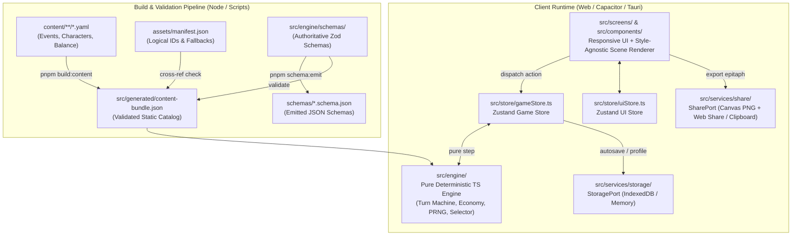
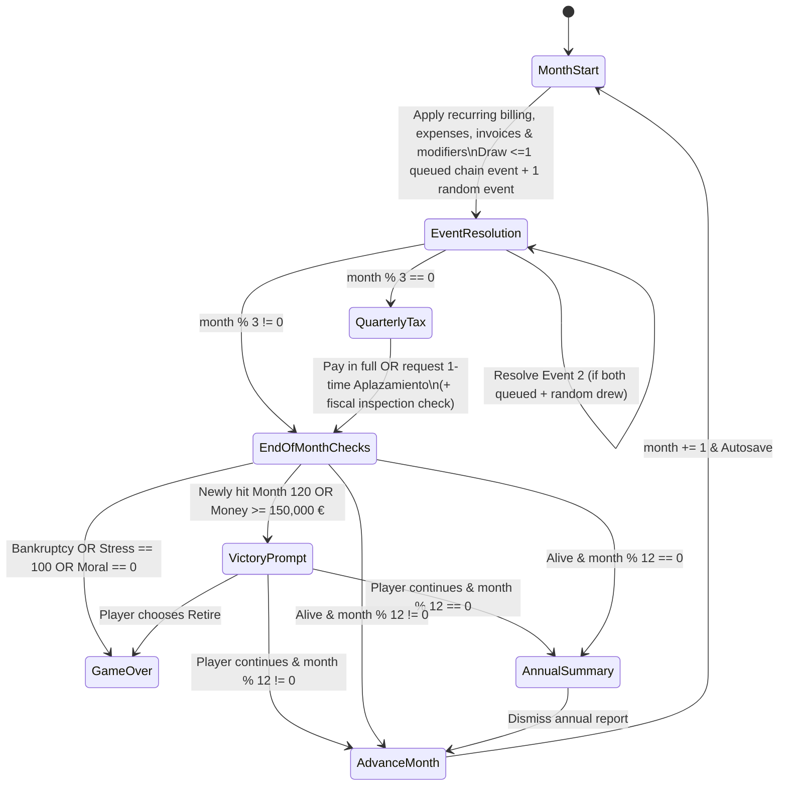

# Architecture — Autónomo Simulator

> Technical architecture and executable contracts for **Autónomo Simulator** (see [Autonomo_Simulator_PRD_v1.md](./Autonomo_Simulator_PRD_v1.md) for product vision and [AGENTS.md](./AGENTS.md) for multi-agent governance).

---

## 1. Architectural Overview & Core Principles

Autónomo Simulator is a **mobile-first, offline-capable, single-codebase satirical survival game** built with **React, TypeScript, Vite, Tailwind CSS, and Zustand**. Each turn simulates one month of life as a self-employed worker (*autónomo*) in Spain across a 120-month (10-year) target campaign, with optional Endless continuation.

### Core Invariants
1. **Pure Deterministic Simulation Engine**: `src/engine/` is a zero-dependency TypeScript domain package (except `zod`). It never imports React, DOM APIs, `window`, `IndexedDB`, `Date.now()`, or `Math.random()`. Given `(GameState, PlayerAction)`, the engine deterministically produces `(NextGameState, TurnResolution)`.
2. **Data-Driven Content Compiled at Build Time**: Narrative events, characters, and balance tables live in `content/` as YAML files. A build/validation pipeline parses, validates (schema + cross-reference graph), and compiles them into static typed JSON bundles—no runtime YAML parsing, no `eval()`, and zero possibility of shipping malformed content.
3. **Decoupled Multi-Agent Boundaries**: Programmer (`src/`), Narrative (`content/`), and Art (`assets/`) collaborate strictly through versioned contracts (`schemas/*.schema.json` and `assets/manifest.json`), never blocking one another.
4. **Language Split**: Technical docs, TypeScript identifiers, and YAML schema keys are **English**. Player-facing strings and domain content IDs (e.g., `cliente_pago_sin_factura`) are **Spanish (`es-ES`)**.
5. **Local-First & Zero Backend**: All state, run history, achievements, and share-card rendering execute 100% client-side, ready for static web hosting (itch.io) and future Capacitor (Android/iOS) and Tauri (Desktop/Steam) wrappers.

### Resolved Architectural Decisions (PRD §16)

| PRD Open Item | Architectural Decision |
|---|---|
| **§16.1 Player Stats & Stress** | **5 visible indicators**: `money` (€), `moral` (0–100), `stress` (0–100), `personal_life` (0–100), `reputation` (0–100). Both `stress = 100` (*"Baja por ansiedad"*) and `moral = 0` (*"A preparar oposiciones / volver a oficina"*) are lethal with distinct satirical endings. |
| **§16.2 Economy, Taxes & Insolvency** | Baseline monthly billing (scaled by `reputation`, `moral`, `employee`) + event gigs. Official billing accrues a simplified tax liability settled every 3rd month (*"El Trimestre"*). Cash can dip negative (*"Números rojos"*, adding monthly Stress) plus 1 active tax deferral (*"Aplazamiento"*). **Bancarrota** triggers after 3 consecutive negative months, breaching a hard debt floor (default `-5,000 €`), or defaulting on deferred taxes. |
| **§16.3 Turn Pacing** | **1 random event + at most 1 scheduled chain follow-up** per month (excess queued follow-ups spill over FIFO to the next month), plus quarterly tax settlements (every 3rd month) and annual summaries (every 12th month), targeting ~15–25 min for 120 months. |
| **§16.4 Event Schema & RNG** | Choices support **both** deterministic `effects` and weighted random `outcomes[]` (with immediate `result_text`) plus delayed `schedule_events`, driven by the seeded PRNG. Inline `es-ES` text uses deterministic `<event_id>.<choice_id>` paths for future i18n. |
| **§16.5 Visual Style & Assets** | Locked in [docs/ART_DIRECTION.md](./docs/ART_DIRECTION.md) (Franco-Spanish satirical editorial comic in `.webp` + reactive `.svg` props/fallbacks, `render_mode: "vector_hd"`). `assets/manifest.json` (`placeholder \| ready`) and multi-expression NPC maps decouple Narrative from Art (see [ADR 001](./docs/adr/001-art-direction-webp-and-expressions.md)). |
| **§16.6 MVP Entity Scope** | Basic playable implementations of **Gestor**, **Partner/Children**, and **Employee (max 1)** are all included in the v1 `GameState`, `event.schema.json`, UI, and initial 30–50 MVP event pool. |
| **§16.7 Endless Mode** | Both victories (`month === 120` *«¡Eres un héroe!»* and `money >= 150,000 €` *«Ricachón»*) fire once with an option to **Retire** or **Keep Playing** under normal rules; earned victory badges persist onto the final share card even if the player later loses. |
| **§16.8 Agent Integration & Saves** | Trunk-based `main` with role branches/worktrees (`engine/*`, `content/*`, `art/*`), `pnpm verify` CI gates, repo-native `docs/proposals/` & `docs/adr/`, single roguelite autosave + persistent Hall of Fame/Achievements in IndexedDB, and client-side Canvas PNG + text sharing. |

---

## 2. System Context & Module Topology



### Repository Structure

```text
autonomo-simulator/
├── AGENTS.md                        # Canonical multi-agent rules, permissions, commands & DoD
├── ARCHITECTURE.md                  # System design, state contracts, turn pipeline & packaging
├── Autonomo_Simulator_PRD_v1.md     # Product Requirements Document (es-ES)
├── docs/
│   ├── ART_DIRECTION.md             # Visual style guide, palette, specs (authored before scale art)
│   ├── qa/                          # Structured manual test plans & live QA checklists
│   ├── proposals/                   # Cross-agent mechanic & asset requests (NNN-slug.md)
│   └── adr/                         # Architecture Decision Records (NNN-slug.md)
├── schemas/                         # Generated JSON Schemas (do not hand-edit)
│   ├── event.schema.json
│   ├── character.schema.json
│   ├── balance.schema.json
│   └── asset-manifest.schema.json
├── content/
│   ├── config/
│   │   └── balance.yaml             # Parameterized initial stats, tax rates, caps, thresholds
│   ├── characters/                  # Recurring NPC definitions (gestores, partners, employees)
│   └── events/
│       ├── clientes/
│       ├── hacienda/
│       ├── familia/
│       ├── empleados/
│       └── gestor/
├── assets/
│   ├── manifest.json                # Logical asset registry (status: placeholder | ready)
│   ├── characters/
│   ├── backgrounds/
│   ├── illustrations/
│   ├── animations/
│   └── ui/
├── src/
│   ├── engine/                      # Pure TS simulation package (NO React/DOM/IO imports)
│   │   ├── schemas/                 # Zod schemas (single source of truth)
│   │   ├── prng.ts                  # Seeded serializable PRNG (mulberry32/sfc32)
│   │   ├── state.ts                 # GameState factory & initializers
│   │   ├── economy.ts               # Monthly billing, expenses, quarterly tax & insolvency math
│   │   ├── selector.ts              # Eligibility filtering, cooldowns & weighted event selection
│   │   ├── effects.ts               # Declarative effect & weighted outcome applicator
│   │   ├── turn.ts                  # Deterministic turn state machine
│   │   └── index.ts                 # Public engine API
│   ├── generated/                   # Build-time compiled catalog (gitignored or deterministic artifact)
│   ├── store/
│   │   ├── gameStore.ts             # Zustand wrapper around pure engine + autosave trigger
│   │   └── uiStore.ts               # Ephemeral UI state (tabs, modals, drawers, motion prefs)
│   ├── services/
│   │   ├── storage/                 # StoragePort + IndexedDB adapter + save migrations
│   │   ├── share/                   # Canvas PNG renderer + Web Share / Clipboard adapter
│   │   ├── i18n/                    # Lightweight string resolver (inline es-ES + future overlay)
│   │   └── platform/                # Capacitor / Tauri / Web runtime capability detection
│   ├── components/
│   │   ├── hud/                     # 5-indicator bar, calendar badge, Números Rojos alert
│   │   ├── event/                   # Event card, choice buttons, outcome toast/panel
│   │   ├── scene/                   # Style-agnostic office scene renderer & asset resolver
│   │   └── modals/                  # Quarterly Trimestre, Annual Summary, Victory, Game Over
│   └── screens/
│       ├── TitleScreen.tsx          # New run, continue active run, Hall of Fame, Achievements
│       ├── GameScreen.tsx           # Adaptive mobile (tabbed) / desktop (multi-panel) workspace
│       └── EndRunScreen.tsx         # Epitaph summary + Canvas card preview + Share actions
├── scripts/
│   ├── emit-schemas.ts              # Exports Zod schemas -> schemas/*.schema.json
│   ├── validate-content.ts          # Schema + semantic graph + asset manifest validator
│   ├── validate-assets.ts           # Verifies file existence, formats, dimensions vs manifest.json
│   └── compile-content.ts           # Compiles validated YAML -> src/generated/content-bundle.json
└── tests/
    ├── engine/                      # Unit tests for economy, taxes, insolvency, PRNG, effects
    ├── content/                     # Automated validation of real content/ YAML files
    ├── simulation/                  # Monte Carlo balance, reachability & deadlock runners
    └── ui/                          # Playwright responsive (mobile + desktop) & accessibility E2E
```

---

## 3. Domain Model & `GameState` Contract

All monetary values in `GameState` are stored as **whole integer Euros (`number`, `Math.round`)** to prevent IEEE-754 floating-point drift and keep player-facing figures crisp. All bounded indicators are integers clamped to `[0, 100]`.

### 3.1 Core State Interfaces (`src/engine/types.ts`)

```typescript
export type EndingId =
  | "defeat_bankruptcy"          // Insolvencia / Bancarrota
  | "defeat_burnout_stress"      // Stress = 100 ("Baja por ansiedad")
  | "defeat_resignation_moral"   // Moral = 0 ("A preparar oposiciones / volver a oficina")
  | "abandon_oposiciones"        // Narrative voluntary exit
  | "abandon_salaried"           // Narrative voluntary exit
  | "abandon_subsidies"          // Narrative voluntary exit
  | "retired_hero"               // Voluntary retirement at/after Month 120
  | "retired_rich";              // Voluntary retirement at/after 150,000 €

export type VictoryBadge = "hero_120m" | "rich_150k";

export interface Indicators {
  money: number;          // Available liquid cash (€); may go negative ("Números rojos")
  moral: number;          // 0..100; 0 triggers defeat_resignation_moral; scales productivity
  stress: number;         // 0..100; 100 triggers defeat_burnout_stress
  personal_life: number;  // 0..100; modulates family/personal events & passive recovery
  reputation: number;     // 0..100; scales baseline monthly billing & unlocks client tiers
}

export interface PrngState {
  seed: string;           // Human-shareable run seed (e.g. "AUT-2026-X9K2")
  state: [number, number, number, number]; // Serializable sfc32 internal words
}

export interface DeferredTaxDebt {
  principal: number;
  surcharge: number;      // Total due = principal + surcharge
  due_month: number;      // Always creation_month + 3 (next Trimestre)
}

export interface PendingInvoice {
  id: string;
  source_event_id: string;
  amount: number;
  due_month: number;
  default_prob: number;   // 0..1; rolled on due_month via PRNG
}

export interface FinanceState {
  lifetime_billed: number;             // Cumulative official invoiced revenue (excludes "en B")
  current_quarter_billed: number;      // Resets every 3 months
  accrued_tax_liability: number;       // Simplified IVA + IRPF owed at next Trimestre
  deferred_tax: DeferredTaxDebt | null;// Max 1 active "Aplazamiento" at a time
  pending_invoices: PendingInvoice[];
  consecutive_negative_months: number; // 0..3; >= 3 triggers defeat_bankruptcy
}

export interface GestorState {
  tier: "self" | "cheap" | "premium";
  character_id: string | null;
  monthly_fee: number;
  inspection_shield: number;           // Reduces fiscal_risk / error probability
  months_active: number;
}

export interface FamilyState {
  status: "single" | "dating" | "cohabiting" | "separated";
  partner_character_id: string | null;
  children_count: number;
  monthly_cost: number;
  support_modifier: number;            // Modulates stress recovery / emergency family support
}

export interface EmployeeState {
  character_id: string;
  role_label: string;
  monthly_cost: number;                // Salary + Seguridad Social simplified lump cost
  billing_multiplier: number;          // e.g. 1.35x on baseline monthly billing
  satisfaction: number;                // 0..100; drives employee event eligibility
  months_employed: number;
}

export interface ScheduledEvent {
  queue_id: string;
  event_id: string;
  trigger_month: number;
  source_event_id: string;
}

export interface TemporalModifier {
  id: string;
  label: string;                       // Displayed in status details (es-ES)
  remaining_months: number;
  monthly_billed_delta?: number;
  monthly_expense_delta?: number;
  monthly_moral_delta?: number;
  monthly_stress_delta?: number;
}

export interface GameState {
  schema_version: 1;
  run_id: string;
  prng: PrngState;
  month: number;                       // Starts at 1; Year = ceil(month / 12)
  phase: TurnPhase;                    // Current step within the monthly state machine
  indicators: Indicators;
  fiscal_risk: number;                 // 0..100 internal tension gauge (partially obfuscated in UI)
  finances: FinanceState;
  gestor: GestorState;
  family: FamilyState;
  employee: EmployeeState | null;      // Hard cap: max 1 employee
  flags: Record<string, boolean | number>;
  cooldowns: Record<string, number>;   // event_id -> earliest next eligible month
  occurrences: Record<string, number>; // event_id -> times seen this run
  scheduled_queue: ScheduledEvent[];   // Sorted by (trigger_month ASC, insertion order ASC)
  modifiers: TemporalModifier[];
  current_turn_events: string[];       // Up to 2 event IDs drawn for the active month
  earned_victories: VictoryBadge[];
  endless_mode: boolean;
  ending: { id: EndingId; month: number; summary_quote: string } | null;
  annual_snapshot: AnnualAccumulator;  // Reset each month 12 after generating AnnualSummary
  history: HistoryEntry[];             // Bounded ring/list of key choices & milestones
}
```

### 3.2 Initial Run State (Month 1 Defaults — Parameterized in `content/config/balance.yaml`)
- Starts at `month: 1`, `family.status: "single"`, `family.children_count: 0`, `employee: null`, `gestor.tier: "self"`.
- Initial indicators (calibratable in `balance.yaml`, see [ADR 002](./docs/adr/002-cashflow-timing-and-economy-tuning.md)): `money: 2600` (`~3,216 €` after Month 1 recurring step, `~2,596 €` net after accrued tax reserve), `moral: 75`, `stress: 20`, `personal_life: 65`, `reputation: 35`, `fiscal_risk: 0`.

---

## 4. Monthly Turn Pipeline & Economy Rules

The engine executes each month as an explicit, serializable state machine (`TurnPhase`) so saving/reloading mid-month (e.g., while viewing an event card or the Trimestre modal) restores the exact screen without re-rolling RNG.



### 4.1 Deterministic Step Semantics

1. **`MonthStart` (Recurring Economy & Timers)**:
   - Collect maturing `pending_invoices` where `due_month === month`: roll `default_prob` against `prng`. Paid invoices add to `money` (tax was accrued on issuance or on collection per `balance.yaml` standard—default: **cash-basis tax accrual on collection** so unpaid invoices hurt liquidity without double-taxing uncollected money, unless flagged otherwise). Unpaid invoices emit a notice and unlock client-chase flags.
   - Compute **Baseline Monthly Billing**:
     $$\text{grossBilling} = \text{round}\Big(\text{baseRate} \times f_{\text{rep}}(\text{reputation}) \times f_{\text{moral}}(\text{moral}) \times \text{employeeMultiplier} + \Delta_{\text{modifiers}}\Big)$$
   - Apply official billing:
     - `indicators.money += grossBilling`
     - `finances.lifetime_billed += grossBilling`
     - `finances.current_quarter_billed += grossBilling`
     - `finances.accrued_tax_liability += round(grossBilling * balance.effective_quarterly_tax_rate)`
   - Deduct **Recurring Monthly Obligations**:
     - `totalExpenses = baseLivingCost + autonomoQuota + gestor.monthly_fee + family.monthly_cost + (employee?.monthly_cost ?? 0) + modifierExpenses`
     - `indicators.money -= totalExpenses`
   - Tick `TemporalModifier`s (`remaining_months -= 1`, apply monthly stat deltas, prune expired).

2. **`EventDraw` & `EventResolution` (Pacing Cap: Max 2 Cards/Month)**:
   - **Slot 1 (Scheduled Chain Follow-Up)**: Inspect `scheduled_queue` for entries with `trigger_month <= month` whose `event_id` still meets hard state invariants. Pop **at most 1** (FIFO). Any remaining due entries stay at the front of `scheduled_queue` and automatically resolve next month.
   - **Slot 2 (Weighted Random Event)**: Filter the compiled catalog by `requirements`, `cooldowns`, `max_occurrences`, and `exclusive_with` (excluding Slot 1's event). Select **1** event via weighted PRNG draw. A small fallback pool of evergreen low-cooldown events ensures Slot 2 never starves.
   - **Choice Resolution**: When the player selects `choice_id`:
     - Validate choice is eligible in current state.
     - If `choice.outcomes` is present, roll one `Outcome` by `weight` using `prng`; otherwise apply `choice.effects` directly.
     - Apply all deltas, clamp stats to `[0, 100]`, enqueue `schedule_events`, and record a `HistoryEntry`.
     - Snapshot `TurnResolution.postChoiceState` at `month = N` immediately after `resolveChoiceEffects` (before `transitionAfterTurnEvents` / `advanceToNextMonth`) so the UI can display exact Month `N` outcome deltas prior to applying Month `N+1` recurring cashflow (see [ADR 002](./docs/adr/002-cashflow-timing-and-economy-tuning.md)). Pure helpers `computeReservedTaxObligation(state)` and `computeNetCashAfterTaxReserve(state)` expose accrued + deferred Hacienda obligations alongside raw `indicators.money`.

3. **`QuarterlyTax` (*"El Trimestre"* — Months 3, 6, 9, 12, ...)**:
   - **Gestor & Hacienda Check**:
     - If `gestor.tier === "self"` or `"cheap"`, roll against `gestor` error rate for minor filing surcharges or missed deductions.
     - Roll `fiscal_risk` against `balance.inspection_curve` (mitigated by `gestor.inspection_shield`). If triggered, queue an immediate or next-month Hacienda inspection chain and decay `fiscal_risk`.
   - **Maturing Deferral First**: If `finances.deferred_tax` is due this month (`due_month === month`), its `principal + surcharge` is mandatory—if `money - mandatoryDue < balance.hard_debt_floor` or cannot be settled per deferral rules, **Bancarrota** triggers (no chaining a second deferral onto a defaulted deferral).
   - **Current Quarter Bill (`accrued_tax_liability`)**:
     - **Option A — Pay in Full**: `money -= accrued_tax_liability`; `accrued_tax_liability = 0`.
     - **Option B — Request *"Aplazamiento"* (enabled only when `deferred_tax === null` and `accrued_tax_liability > 0`)**: Moves `accrued_tax_liability` into `deferred_tax` due at `month + 3` with `balance.deferral_surcharge_pct` (e.g., `+10%`) and applies immediate `stress` penalty (e.g., `+8`).

4. **`EndOfMonthChecks` (Insolvency, Burnout, Victories, Annual Report)**:
   - **Insolvency (*"Números Rojos"*)**:
     - If `indicators.money < 0`: increment `consecutive_negative_months` and apply `balance.negative_cash_monthly_stress` (e.g., `+6` Stress).
     - Else: reset `consecutive_negative_months = 0`.
     - Trigger `defeat_bankruptcy` if `consecutive_negative_months >= 3` OR `indicators.money < balance.hard_debt_floor` (default `-5000`) OR deferred tax default occurred.
   - **Psychological Defeat**:
     - If `indicators.stress >= 100`: trigger `defeat_burnout_stress` (*"Baja por ansiedad"*).
     - Else if `indicators.moral <= 0`: trigger `defeat_resignation_moral` (*"A preparar oposiciones / volver a oficina"*).
   - **Victories (One-Time Prompts)**:
     - If `month >= 120` and `"hero_120m"` not in `earned_victories`: award `"hero_120m"`, prompt **Retire (`retired_hero`)** vs **Continue (`endless_mode = true`)**.
     - If `indicators.money >= 150000` and `"rich_150k"` not in `earned_victories`: award `"rich_150k"`, prompt **Retire (`retired_rich`)** vs **Continue (`endless_mode = true`)**.
   - **Annual Summary (`month % 12 === 0`)**: Emit `AnnualSummary` (yearly billed, taxes paid, net cash change, family/employee milestones, highlight events) and reset `annual_snapshot`.

---

## 5. Declarative Content & Schema Architecture

### 5.1 Authoritative Schema Pipeline
1. Programmer defines schemas in `src/engine/schemas/*.ts` using **Zod**.
2. `pnpm schema:emit` exports standard JSON Schema Draft 2020-12 files to `schemas/event.schema.json`, `schemas/character.schema.json`, `schemas/balance.schema.json`, and `schemas/asset-manifest.schema.json` (providing IDE autocomplete for Narrative and Art agents).
3. `pnpm build:content` parses all `content/**/*.yaml` via `yaml`, validates every document with Zod + semantic graph rules, and writes `src/generated/content-bundle.json`.

### 5.2 Event YAML v1 Specification

```yaml
schema_version: 1
id: cliente_pago_sin_factura
category: clientes # clientes | hacienda | familia | empleados | gestor
title: "¿Con IVA o... nos arreglamos?"
body: "Un cliente urgente te ofrece 1.800 € en mano si le haces el encargo este fin de semana «sin papeleos»."
tags: [dinero_b, dilema_fiscal, fin_de_semana]
character_id: cliente_regateador        # Optional: must exist in content/characters/
character_expression: angry             # Optional: neutral | stressed | angry | pleased (falls back to portrait_asset_id)
illustration_id: null                   # Optional: if set, must exist in assets/manifest.json

requirements:
  min_month: 3
  max_month: null
  stats:
    reputation: { min: 15 }
  required_flags: []
  forbidden_flags: [inspeccion_en_curso]
  gestor_tiers: [self, cheap, premium]  # Optional filter
  family_statuses: null                 # Optional filter
  has_employee: null                    # true | false | null (any)

weight: 12
cooldown_months: 18
max_occurrences: 3
exclusive_with: []

choices:
  - id: aceptar_efectivo
    label: "Aceptar el sobre y trabajar el finde"
    outcomes:
      - id: cobro_limpio
        weight: 75
        result_text: "Cobras al contado el domingo por la noche. Ni rastro en el banco, pero duermes regular."
        effects:
          cash_delta: 1800              # Untaxed cash; does NOT increment lifetime_billed or tax accrual
          stress: 8
          moral: -3
          personal_life: -6
          fiscal_risk: 22
          set_flags: [cobro_en_b_reciente]
          schedule_events:
            - event_id: hacienda_carta_certificada
              delay_months: 6
              probability: 0.25
      - id: billete_falso_o_regateo
        weight: 25
        result_text: "Al entregar, te suelta solo 1.200 € diciendo que «ya sin IVA te ahorras un pico». Encima no puedes reclamar."
        effects:
          cash_delta: 1200
          stress: 15
          moral: -8
          fiscal_risk: 18
          set_flags: [cobro_en_b_reciente]

  - id: exigir_factura
    label: "Con factura e IVA, como manda la ley"
    effects:                            # Deterministic shorthand when only 1 outcome exists
      billed_income: 1500               # Adds cash, increments lifetime_billed, accrues quarterly tax
      moral: 4
      stress: 4
      reputation: 3

  - id: rechazar_encargo
    label: "Rechazar y descansar el fin de semana"
    effects:
      stress: -6
      personal_life: 5
      reputation: -2
```

### 5.3 Closed Catalog of Effect Primitives (v1)

Narrative agents may **only** combine primitives from this closed catalog. Any new mechanic requires a proposal in `docs/proposals/`.

| Primitive | Type | Engine Behavior |
|---|---|---|
| `billed_income` | `number` (`>= 0`) | Official revenue: adds to `money`, `lifetime_billed`, `current_quarter_billed`, and accrues `accrued_tax_liability`. |
| `cash_delta` | `number` (`+/-`) | Direct untaxed liquidity change (e.g., cash *"en B"*, family gift, personal expense, non-deductible fine). |
| `deductible_expense` | `number` (`>= 0`) | Subtracts from `money` and reduces `accrued_tax_liability` (floored at `0`) by the deductible tax fraction. |
| `deferred_invoice` | `{ amount, delay_months, default_prob }` | Enqueues a `PendingInvoice` collected at `month + delay_months`. |
| `moral`, `stress`, `personal_life`, `reputation`, `fiscal_risk` | `number` (`+/-`) | Additive integer delta clamped to `[0, 100]`. |
| `set_flags` / `clear_flags` | `string[]` | Sets boolean flags `true` or removes them from `state.flags`. |
| `schedule_events` | `{ event_id, delay_months, probability? }[]` | Rolls `probability` (default `1.0`) via `prng`; if hit, inserts into `scheduled_queue` for `month + delay_months`. |
| `add_modifier` | `TemporalModifierSpec` | Attaches a multi-month recurring billing/expense/stat modifier. |
| `set_gestor` | `{ tier, character_id? }` | Switches Gestor tier and updates `monthly_fee` & `inspection_shield` from config/character. |
| `set_family_status` | `{ status, partner_character_id? }` | Updates relationship state and recurring family parameters. |
| `add_child` | `number` (default `1`) | Increments `family.children_count` and adjusts `family.monthly_cost`. |
| `hire_employee` | `{ character_id }` | Populates `state.employee` from `content/characters/<id>.yaml` (rejected by validator if choice lacks `has_employee: false` guard when needed). |
| `dismiss_employee` | `{ severance_cost }` | Deducts `severance_cost` from `money` and sets `state.employee = null`. |
| `trigger_ending` | `EndingId` | Immediately ends the run with a narrative abandonment ending (`abandon_oposiciones`, `abandon_salaried`, `abandon_subsidies`). |

### 5.4 Three-Layer Content Verification
1. **Schema Layer (`Zod`)**: Rejects unknown keys (`strict()`), invalid types, out-of-range weights/probabilities, or empty strings.
2. **Semantic & Graph Layer (`scripts/validate-content.ts`)**:
   - Globally unique `event.id` and `character.id` matching filename (`<id>.yaml`).
   - Every `event` has `>= 2` choices, and **at least 1 choice has no conditional `requirements`** (guarantees a drawn event can never soft-lock the player).
   - Every `schedule_events[].event_id` exists in the catalog; chain-only events (`weight: 0`) must have at least one incoming `schedule_events` edge (no orphan events).
   - Every `character_id` exists in `content/characters/`, every `character.expressions.*` portrait ID exists in `assets/manifest.json` (`category: "character"`), `event.character_expression` requires a non-null `character_id`, and every `illustration_id` exists in `assets/manifest.json`.
   - Cycle detector flags unbounded `delay_months: 0` or inescapable negative loops.
3. **Simulation Layer (`tests/simulation/`)**:
   - Runs 1,000+ headless seeded games across 4 bots (`PrudentBot`, `GreedyEnBBot`, `WorkaholicBot`, `RandomBot`).
   - Asserts zero runtime exceptions, zero deadlocked turns, target survival curve bounds (neither 0% nor 95% survival on `RandomBot`), and reachability metrics across categories.

### 5.5 Localization Readiness
- YAML events store Spanish (`es-ES`) copy inline for minimal Narrative authoring friction.
- All UI renders event copy through `resolveEventText(locale, eventId, fieldPath, fallbackText)`. In MVP (`es-ES`), it returns `fallbackText` directly; future locales (`content/locales/en/*.yaml`) overlay translations keyed by deterministic IDs (`<event_id>.title`, `<event_id>.choices.<choice_id>.label`, `<event_id>.choices.<choice_id>.outcomes.<outcome_id>.result_text`) without altering event schemas.

---

## 6. State Management, Persistence & Share Pipeline

### 6.1 Zustand Store Split (`src/store/`)
- **`useGameStore`**: Holds canonical persisted `activeRun: GameState | null`, two-step outcome snapshot `outcomePreviewState: GameState | null` (`getVisibleGameState(store)`), `queuedPostOutcomeDeltas`, `queuedMonthStart`, and `profile: ProfileEnvelope`. Exposes pure action dispatchers (`startRun(seed?)`, `chooseOption(choiceId)`, `acknowledgeOutcome()`, `settleQuarterlyTax(mode)`, `decideVictory(decision)`, `closeAnnualSummary()`, `abandonActiveRun()`). Every mutating action delegates synchronously to `src/engine/`, stages Month `N` choice deltas before Month `N+1` recurring cashflow (unless `fastPacing` auto-acknowledges non-lethal outcomes), and triggers asynchronous persistence through `StoragePort` (see [ADR 002](./docs/adr/002-cashflow-timing-and-economy-tuning.md)).
- **`useUIStore`**: Holds presentation state and lightweight client preferences (`screenView`, `activeMobileTab`, `activeTitleTab`, `abandonModalOpen`, `reducedMotionOverride`, `sfxMuted` persisted to `"autonomo:sfx_muted"`, `fastPacing` persisted to `"autonomo:fast_pacing"`, and `toast`). Never persisted inside `GameState`.

### 6.2 Roguelite Persistence & Save Migrations (`src/services/storage/`)
Backed by IndexedDB (`idb-keyval`) behind an async `StoragePort` interface:
1. **`autonomo:active_run` (`SaveEnvelope`)**:
   - Single active autosave slot (roguelite model—no manual save-scumming slots).
   - Written automatically after every choice, quarterly resolution, and month advance.
   - Deleted (and archived into `hall_of_fame`) as soon as `ending !== null`.
   - Envelope shape: `{ save_version: 1, engine_build: string, updated_at: string, state: GameState }`.
2. **`autonomo:profile` (`ProfileEnvelope`)**:
   - Persistent across runs: unlocked `achievements: Record<string, string>`, `hall_of_fame: PastRunSummary[]` (capped at e.g. top/last 50 runs), and user accessibility/audio preferences.
3. **Migration Runner**: On boot, `migrateSaveEnvelope(raw)` runs sequential pure functions (`v1 -> v2 -> ...`). If a save is irreparably corrupted, the app backs up the raw blob to `autonomo:corrupt_backup`, notifies the player gracefully without crashing, and preserves `autonomo:profile`.

### 6.3 Shareable Epitaph & Canvas Card (`src/services/share/`)
- Generates two artifacts from `EndRunSummary` (works identically for defeat, voluntary retirement, or Endless demise while displaying earned `VictoryBadge` stamps):
  1. **Formatted Text Snippet**: Compact satirical summary + survival time + cash + lifetime billed + game URL (for WhatsApp paste).
  2. **Client-Side Canvas PNG (`1080×1350` portrait card)**: Rendered via HTML5 `<canvas>` (`OffscreenCanvas` / `<canvas>`) styled like an official stamped Spanish bureaucratic form (*Modelo 036 / Epitafio Autónomo*), embedding stats, earned victory seals, and satirical quote.
- Delivery hierarchy:
  1. Native Share Sheet (`navigator.canShare({ files })` on mobile browsers / Capacitor Share plugin) -> shares PNG + text directly to WhatsApp/Telegram/social.
  2. Fallback one-tap **"Copiar resumen"** (`navigator.clipboard.writeText`) + **"Descargar tarjeta PNG"** (`<a download>`).

---

## 7. UI/UX, Style-Agnostic Scene Renderer & Accessibility

### 7.1 Responsive Layout Architecture (Mobile-First, Single-Screen Desktop)
- **Mobile (`< 1024px` — `360×780` & `390×844`)**:
  - Sticky compact top HUD (`<= 140px`): Month/Year (`Año 3 · Mes 2 · Trimestre en 1 mes`), `Money` + tax-adjusted `Libre` strip, and 4 aligned micro-gauges (`Moral`, `Stress`, `Personal Life`, `Reputation`).
  - Main viewport: Compact Office Header Strip + prominent **Event Card** with thumb-friendly (`min-height: 48px`, `>= 6px` gap) choice buttons and bottom padding clearing the fixed bottom bar. Automatic `window.scrollTo({ top: 0 })` runs on turn-state transitions (`event -> outcome -> next event`) whenever `scrollY > 0` so players never have to manually scroll back up to read outcomes.
  - Bottom Navigation Bar: `Despacho` (Play), `Cuentas` (Trimestre accrual, fixed costs, invoices), `Entorno` (Gestor, Family, Employee), `Historial` (Log & Achievements).
- **Desktop (`>= 1024px` — `1366×768` laptop & `1440×900`+ desktop)**:
  - Dedicated 3-column workspace engineered to fit **100% within a single screen (`scrollY === 0`, `scrollHeight <= innerHeight + 2`)** so players never yo-yo scroll down for choices and back up for outcomes:
    - **Left Panel**: Live **Office Scene** (viewport-proportioned height, reactive desk props, character portrait) + compact `Entorno` status cards.
    - **Center Stage**: 1-line horizontal monthly cashflow ticker, height-capped (`98px–148px`) comic banner with non-overlapping NPC Polaroid, event narrative card, all choice buttons (`1`–`4`), and immediate above-the-fold outcome panel.
    - **Right Panel**: Compact Financial Ledger (*"Cuaderno de Cuentas"*), quarterly tax reserve tracker, active temporal modifiers, and internally scrollable `Diario de Expediente` + `Sellos de carrera` panels.

### 7.2 Asset Manifest, Multi-Expression Portraits & Style-Agnostic Scene Renderer
Per [docs/ART_DIRECTION.md](./docs/ART_DIRECTION.md) and [ADR 001](./docs/adr/001-art-direction-webp-and-expressions.md), `assets/manifest.json` registers all `.webp` comic panels/portraits and standalone `.svg` props/fallbacks under logical `snake_case` IDs:

```json
{
  "schema_version": 1,
  "default_render_mode": "vector_hd",
  "assets": {
    "char_gestor_barato_paco": {
      "path": "characters/char_gestor_barato_paco.webp",
      "category": "character",
      "width": 512,
      "height": 512,
      "render_mode": "vector_hd",
      "status": "ready"
    },
    "char_gestor_barato_paco_estresado": {
      "path": "characters/char_gestor_barato_paco_estresado.webp",
      "category": "character",
      "width": 512,
      "height": 512,
      "render_mode": "vector_hd",
      "status": "ready"
    }
  },
  "fallbacks": {
    "clientes": "ui/fallback_clientes.svg",
    "hacienda": "ui/fallback_hacienda.svg",
    "familia": "ui/fallback_familia.svg",
    "empleados": "ui/fallback_empleados.svg",
    "gestor": "ui/fallback_gestor.svg"
  }
}
```

- **Multi-Expression NPC Resolution**: Character YAMLs (`content/characters/<id>.yaml`) optionally declare `expressions: { neutral?, stressed?, angry?, pleased? }` mapping to `character` entries in `assets/manifest.json`, while events optionally set `character_expression`. UI resolves `character.expressions?.[expression] ?? character.portrait_asset_id` inside a modular CSS Polaroid frame.
- **Binary Dimension & Budget Validation (`scripts/validate-assets.ts`)**: Accepts only `.webp` (verifying `RIFF....WEBP` magic bytes and exact `VP8 ` / `VP8L` / `VP8X` pixel `width` × `height`) and standalone `.svg` (`xmlns` + dimensions), enforcing per-category caps (`background <= 145 KB`, `illustration <= 125 KB`, `character <= 70 KB`, `ui <= 20 KB`) and a `<= 2.2 MB` total `assets/` payload ceiling.
- `SceneRenderer` applies CSS scaling rules per asset's `render_mode` (`image-rendering: pixelated` for `"pixel_art"` sprites vs smooth high-DPI scaling for `"vector_hd"` WebP/SVG).
- Upgrading an asset from `"placeholder"` to `"ready"` requires zero changes to `src/` or `content/`.

### 7.3 Accessibility, UX Ergonomics & Performance Budgets
- Full keyboard playability (`1`–`9` choices, `Enter`/`Space` confirm, `Esc` close non-mandatory drawers), visible `:focus-visible` rings, no hover-only disclosures, and zero scroll drift across keyboard turns.
- **Viewport & Hit-Target Ergonomics**: Primary CTAs on `TitleScreen` (including active-run resume), `QuarterlyTaxModal`, `AbandonRunModal`, and `EndRunScreen` (illustration + `<canvas>` certificate + Share/Replay actions) sit 100% above the fold on `1366×768` and `1440×900`. Interactive buttons/tabs maintain unoccluded pointer centers (`document.elementFromPoint`), `AchievementToast` anchors away from primary turn controls (`top-[7.5rem]` on mobile, `bottom-4 right-4` on desktop), and narrative/choice copy never truncates silently (`scrollHeight <= clientHeight`, no `ellipsis`) while maintaining legibility floors (`>= 17px` event title, `>= 13.5px` body/choices, `>= 12px` HUD money).
- Semantic landmarks, `aria-live="polite"` announcements for outcome text and stat changes, WCAG AA contrast (`>= 4.5:1`), colorblind-safe `+`/`-` directional icons alongside green/red stat badges.
- Respects `prefers-reduced-motion` (disables shake/confetti/desk transitions).
- Initial JS + compiled content bundle target: `< 250 KB` gzipped for instant mobile load over 4G.

---

## 8. Build, Verification & Multi-Platform Packaging

### 8.1 Verification, Live QA & Release Pipeline
Every completed task or milestone runs a full verification + QA + delivery sequence before completion:

1. **Automated Static, Unit & Build Gate (`pnpm verify`)**:
   - `pnpm schema:check` — Ensures `schemas/*.schema.json` matches `src/engine/schemas/`.
   - `pnpm validate:assets` — Verifies every entry in `assets/manifest.json` exists on disk and matches declared format/dimensions.
   - `pnpm validate:content` — Validates all YAML files against Zod + semantic graph + manifest references, and compiles `src/generated/content-bundle.json`.
   - `pnpm typecheck` — `tsc --noEmit`.
   - `pnpm lint` — `biome check .`.
   - `pnpm test` — `vitest run` (engine unit tests + content tests + fast seeded simulation smoke suite).
   - `pnpm build` — Production Vite bundle (`dist/`) verifying zero bundling or asset-resolution errors.
2. **Structured Manual Test Plan, Usability Audit & Playwright Execution (Local -> Live Vercel Production)**:
   - Every user-facing feature maintains human-readable test scenarios in `docs/qa/manual-test-plan.md` (covering preconditions, user journeys, edge cases, narrow mobile `360×780`, mobile `390×844`, compact laptop `1366×768`, and desktop `1440×900` multi-panel layout).
   - Agents **execute** automated E2E regressions (`tests/ui/phase*.spec.ts`), the dedicated **Usability & UX Audit Suite (`tests/ui/ux-usability.spec.ts`)** (verifying zero desktop yo-yo scroll without `scrollIntoViewIfNeeded()`, above-the-fold CTAs, mobile scroll-reset + bottom-nav clearance, `document.elementFromPoint` hit-target non-occlusion including live toasts, zero silent text truncation, legibility floors, and keyboard ergonomics), and interactive walkthrough scenarios via **Playwright** against the real production build—verifying DOM layout, visual screenshots, IndexedDB save/reload persistence, HTTP asset responses, and **zero** browser `console.error` / `pageerror` events.
   - **Local vs Live Vercel Production Parity (`playwright.config.ts` & `playwright.prod.config.ts`)**:
     - **Local Pre-Push Gate (`pnpm test:e2e`)**: Playwright boots `pnpm preview` (`http://localhost:4173` serving `dist/`) and runs all checks locally before commit/push.
     - **Live Production Post-Deploy Gate (`pnpm test:e2e:prod`)**: Runs the exact same mobile + desktop E2E and QA verification suite against the live Vercel production deployment at `https://autonomo-simulator.vercel.app/` (cross-platform via `playwright.prod.config.ts` with `webServer: undefined`; custom preview URLs can override via `PLAYWRIGHT_BASE_URL`).
3. **Git Delivery & Post-Deploy Verification**:
   - Once all checks, automated tests, `pnpm build`, and local `pnpm test:e2e` succeed, changes are committed and pushed to GitHub (`origin`), triggering Vercel CD to `https://autonomo-simulator.vercel.app/`, followed by `pnpm test:e2e:prod` to verify the live deployment.

### 8.2 Multi-Platform Packaging Roadmap
All platform-specific capabilities (storage persistence hints, native share, haptics, external links, window quit) sit behind `src/services/platform/PlatformPort.ts`:
1. **Phase 1 — Web HTML5 (MVP — Live on Vercel)**: Static Vite build (`dist/`) with relative base path (`base: './'`) deployed continuously to Vercel production at `https://autonomo-simulator.vercel.app/` (verified post-deploy via `pnpm test:e2e:prod`), while keeping the identical static bundle portable to root domains, subpaths, or itch.io iframes, plus optional PWA service worker for offline caching.
2. **Phase 2 — Android & iOS (`Capacitor`)**: Wraps `dist/`; swaps `WebShareAdapter` for `@capacitor/share` + `@capacitor/filesystem` (for PNG card sharing), handles notch/gesture insets via CSS `env(safe-area-inset-*)`, and requests persistent storage so OS cache eviction does not wipe `IndexedDB`.
3. **Phase 3 — Desktop Windows/macOS/Linux (`Tauri v2`)**: Wraps `dist/` in native WebView; routes save/profile files optionally to OS app-data directory via Tauri FS adapter (`StoragePort`) for Steam Cloud compatibility while keeping the entire React + Engine codebase untouched.
