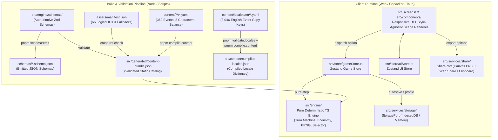
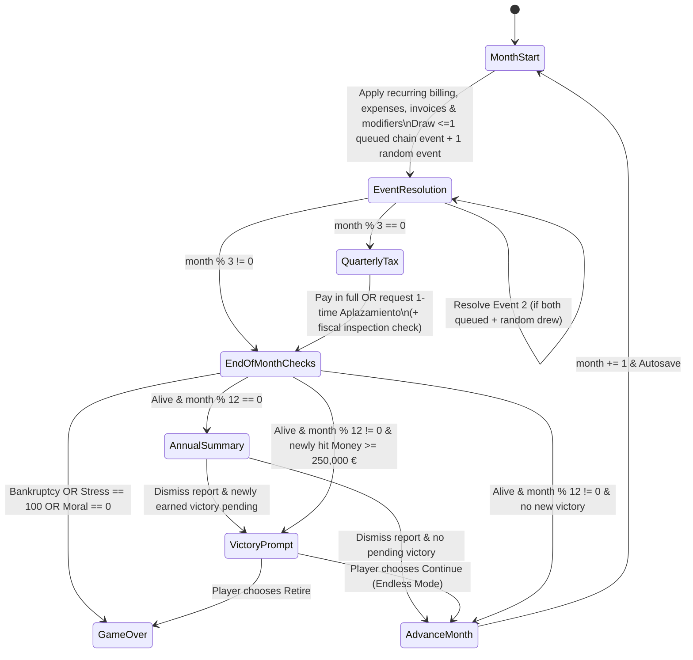

# Architecture — Autónomo Simulator

> Technical architecture and executable contracts for **Autónomo Simulator** (see [Autonomo_Simulator_PRD_v1.md](./Autonomo_Simulator_PRD_v1.md) for product vision and [AGENTS.md](./AGENTS.md) for multi-agent governance).

---

## 1. Architectural Overview & Core Principles

Autónomo Simulator is a **mobile-first, offline-capable, single-codebase satirical survival game** built with **React, TypeScript, Vite, Tailwind CSS, and Zustand**. Each turn simulates one month of life as a self-employed worker (*autónomo*) in Spain across a 120-month (10-year) target campaign, with optional Endless continuation.

### Core Invariants
1. **Pure Deterministic Simulation Engine**: `src/engine/` is a zero-dependency TypeScript domain package (except `zod`). It never imports React, DOM APIs, `window`, `IndexedDB`, `Date.now()`, or `Math.random()`. Given `(GameState, PlayerAction)`, the engine deterministically produces `(NextGameState, TurnResolution)`.
2. **Data-Driven Content Compiled at Build Time**: Narrative events, characters, and balance tables live in `content/` as YAML files. A build/validation pipeline parses, validates (schema + cross-reference graph), and compiles them into static typed JSON bundles—no runtime YAML parsing, no `eval()`, and zero possibility of shipping malformed content.
3. **Decoupled Multi-Agent Boundaries**: Programmer (`src/`), Narrative (`content/`), and Art (`assets/`) collaborate strictly through versioned contracts (`schemas/*.schema.json` and `assets/manifest.json`), never blocking one another.
4. **Language Split**: Technical docs, TypeScript identifiers, and YAML schema keys are **English**. Player-facing strings and domain content IDs (e.g., `cliente_pago_sin_factura`) are **Spanish (`es-ES`)**.
5. **Local-First & Zero Backend**: All state, run history, achievements, and share-card rendering execute 100% client-side, ready for static web hosting (itch.io) and future Capacitor (Android/iOS) and Tauri (Desktop/Steam) wrappers.

### Resolved Architectural Decisions (PRD §16)

| PRD Open Item | Architectural Decision |
|---|---|
| **§16.1 Player Stats & Stress** | **5 visible indicators**: `money` (€), `moral` (0–100), `stress` (0–100), `personal_life` (0–100), `reputation` (0–100). Both `stress = 100` (*"Baja por ansiedad"*) and `moral = 0` (*"A preparar oposiciones / volver a oficina"*) are lethal with distinct satirical endings. |
| **§16.2 Economy, Taxes & Insolvency** | Baseline monthly billing (scaled by `reputation`, `moral`, `business.tier`, 3-Act market squeeze, multi-staff diminishing seat curve, or Boutique Senior Solo bonus) + event gigs (with opt-in `scale_with_tier`). Official billing accrues progressive marginal IRPF + RETA brackets (Autónomo/Estudio) or flat `24%` Impuesto de Sociedades + Autónomo Societario (S.L./Agencia), settled every 3rd month (*"El Trimestre"*), alongside Spain's 4-year *prescripción fiscal* delayed audit ledger (`14–42m` window). Cash can dip negative (*"Números rojos"*, adding monthly Stress) plus 1 active tax deferral (*"Aplazamiento"*). **Bancarrota** triggers after 3 consecutive negative months, breaching a tier-scaled hard debt floor (`-5,000 €` Solo up to `-25,000 €` Agencia), or defaulting on deferred taxes. |
| **§16.3 Turn Pacing** | **1 random event + at most 1 scheduled chain follow-up** per month (prioritizing `priority: "high"` due entries, deferring long-horizon `>= 12m` or high-priority chains up to `12` months, and deduplicating identical `event_id` within `±6` months), plus quarterly tax settlements (every 3rd month) and annual summaries (every 12th month), targeting ~15–25 min for 120 months. |
| **§16.4 Event Schema & RNG** | Choices support **both** deterministic `effects` and weighted random `outcomes[]` (with immediate `result_text`) plus delayed `schedule_events`, driven by the seeded PRNG. Inline `es-ES` text uses deterministic `<event_id>.<choice_id>` paths for bilingual i18n overlays. |
| **§16.5 Visual Style & Assets** | Locked in [docs/ART_DIRECTION.md](./docs/ART_DIRECTION.md) (Franco-Spanish satirical editorial comic in `.webp` + reactive `.svg` props/fallbacks, `render_mode: "vector_hd"`). `assets/manifest.json` (`placeholder \| ready`) and multi-expression NPC maps decouple Narrative from Art (see [ADR 001](./docs/adr/001-art-direction-webp-and-expressions.md)). |
| **§16.6 Entity & Progression Scope (v2)** | Full implementations of **Gestor** (tier-scaled fees + Elena quarterly compliance friction + S.L. `self` penalty), **Partner/Children** (reactive `neglect_months` tracker, dynamic `support_modifier` gating, crisis/synergy weighting), **4 Business Tiers** (`solo_autonomo`, `estudio_consolidado`, `sociedad_limitada`, `agencia_consultora` + Boutique Senior Solo path), and **Multi-Employee Teams** (0–12 staff with named lead character Dani/Laura) per [ADR 004](./docs/adr/004-v2-scaling-progression-and-depth.md). |
| **§16.7 Endless Mode** | Both victories (`month === 120` *«¡Eres un héroe!»* and `money >= 250,000 €` *«Ricachón»* `rich_250k`) fire once with an option to **Retire** or **Keep Playing** under normal rules; earned victory badges persist onto the final share card even if the player later loses. |
| **§16.8 Agent Integration & Saves** | Trunk-based `main` with role branches/worktrees (`engine/*`, `content/*`, `art/*`), `pnpm verify` CI gates, repo-native `docs/proposals/` & `docs/adr/`, single roguelite autosave (`save_version: 2`, lossless `v1 → v2` migration) + persistent Hall of Fame/18 Achievements in IndexedDB, and client-side Canvas PNG + text sharing. |

---

## 2. System Context & Module Topology



### Repository Structure

```text
autonomo-simulator/
├── AGENTS.md                        # Canonical multi-agent rules, permissions, commands & DoD
├── ARCHITECTURE.md                  # System design, state contracts, turn pipeline & packaging
├── Autonomo_Simulator_PRD_v1.md     # Product Requirements Document (es-ES)
├── .github/
│   └── workflows/
│       └── verify.yml               # GitHub Actions CI gate (pnpm verify + pnpm build:itch)
├── docs/
│   ├── ART_DIRECTION.md             # Visual style guide, palette, specs (authored before scale art)
│   ├── qa/                          # Structured manual test plans & live QA checklists
│   ├── proposals/                   # Cross-agent mechanic & asset requests (NNN-slug.md)
│   └── adr/                         # Architecture Decision Records (NNN-slug.md)
├── schemas/                         # Generated JSON Schemas (do not hand-edit)
│   ├── event.schema.json
│   ├── character.schema.json
│   ├── balance.schema.json
│   └── asset-manifest.schema.json
├── content/
│   ├── config/
│   │   └── balance.yaml             # Parameterized initial stats, tax rates, caps, thresholds
│   ├── characters/                  # Recurring NPC definitions (gestores, partners, employees)
│   ├── locales/
│   │   └── en/                      # Category-sharded English ('en') event copy overlays (*.yaml)
│   └── events/                      # 362 Spanish ('es-ES') narrative events across 5 categories
│       ├── clientes/                # 108 events
│       ├── hacienda/                # 66 events
│       ├── familia/                 # 72 events
│       ├── empleados/               # 59 events
│       └── gestor/                  # 57 events
├── assets/
│   ├── manifest.json                # Logical asset registry (66 assets, status: placeholder | ready)
│   ├── characters/
│   ├── backgrounds/
│   ├── illustrations/
│   ├── animations/
│   └── ui/
├── src/
│   ├── content/
│   │   └── compiled-locales.json    # Build-time compiled English ('en') event copy map
│   ├── engine/                      # Pure TS simulation package (NO React/DOM/IO imports)
│   │   ├── schemas/                 # Zod schemas (single source of truth)
│   │   ├── prng.ts                  # Seeded serializable PRNG (mulberry32/sfc32)
│   │   ├── state.ts                 # GameState factory & initializers
│   │   ├── economy.ts               # Monthly billing, expenses, quarterly tax & insolvency math
│   │   ├── selector.ts              # Eligibility filtering, cooldowns & weighted event selection
│   │   ├── effects.ts               # Declarative effect & weighted outcome applicator
│   │   ├── turn.ts                  # Deterministic turn state machine
│   │   └── index.ts                 # Public engine API
│   ├── generated/                   # Build-time compiled catalog (content-bundle.json)
│   ├── store/
│   │   ├── gameStore.ts             # Zustand wrapper around pure engine + autosave trigger
│   │   └── uiStore.ts               # Ephemeral UI state (tabs, modals, drawers, motion prefs)
│   ├── services/
│   │   ├── storage/                 # StoragePort + IndexedDB adapter + save migrations
│   │   ├── share/                   # Canvas PNG renderer + Web Share / Clipboard adapter
│   │   ├── seo/                     # Dynamic per-screen & bilingual SEO metadata manager
│   │   ├── i18n/                    # Bilingual string & event resolver (es-ES + compiled en overlays)
│   │   └── platform/                # Capacitor / Tauri / Web runtime capability detection
│   ├── components/
│   │   ├── hud/                     # 5-indicator bar, ES|EN toggle, calendar badge, Números Rojos alert
│   │   ├── event/                   # Event card, choice buttons, outcome toast/panel
│   │   ├── scene/                   # Style-agnostic office scene renderer & asset resolver
│   │   └── modals/                  # Quarterly Trimestre, Annual Summary, Victory, Game Over
│   └── screens/
│       ├── LandingScreen.tsx        # Clean separated landing overview, Guía Rápida, Ko-fi & future social slot
│       ├── TitleScreen.tsx          # Balanced dossier dashboard: Continue, New Run/Seed, Career Summary, Hall of Fame, Achievements
│       ├── GameScreen.tsx           # Adaptive mobile (tabbed) / desktop (multi-panel) workspace
│       └── EndRunScreen.tsx         # Epitaph summary + Canvas card preview + Share & Ko-fi actions
├── scripts/
│   ├── emit-schemas.ts              # Exports Zod schemas -> schemas/*.schema.json
│   ├── validate-content.ts          # Schema + semantic graph + asset manifest validator
│   ├── validate-assets.ts           # Verifies file existence, formats, dimensions vs manifest.json
│   ├── validate-locales.ts          # Enforces 100% locale key parity & zero orphan keys vs events
│   ├── compile-content.ts           # Compiles validated YAML -> content-bundle.json + compiled-locales.json
│   └── package-itch.ts              # Stages portable relative-path web build -> release/autonomo-simulator-web.zip
└── tests/
    ├── engine/                      # Unit tests for economy, taxes, insolvency, PRNG, effects
    ├── content/                     # Automated validation of real content/ YAML files
    ├── simulation/                  # Monte Carlo balance, reachability & deadlock runners
    └── ui/                          # Playwright responsive (mobile + desktop) & accessibility E2E
```

---

## 3. Domain Model & `GameState` Contract

All monetary values in `GameState` are stored as **whole integer Euros (`number`, `Math.round`)** to prevent IEEE-754 floating-point drift and keep player-facing figures crisp. All bounded indicators are integers clamped to `[0, 100]`.

### 3.1 Core State Interfaces (`src/engine/types.ts`)

```typescript
export type EndingId =
  | "defeat_bankruptcy"          // Insolvencia / Bancarrota
  | "defeat_burnout_stress"      // Stress = 100 ("Baja por ansiedad")
  | "defeat_resignation_moral"   // Moral = 0 ("A preparar oposiciones / volver a oficina")
  | "abandon_oposiciones"        // Narrative voluntary exit
  | "abandon_salaried"           // Narrative voluntary exit
  | "abandon_subsidies"          // Narrative voluntary exit
  | "retired_hero"               // Voluntary retirement at/after Month 120
  | "retired_rich";              // Voluntary retirement at/after 250,000 €

export type VictoryBadge = "hero_120m" | "rich_250k";

export type BusinessTier =
  | "solo_autonomo"
  | "estudio_consolidado"
  | "sociedad_limitada"
  | "agencia_consultora";

export interface BusinessState {
  tier: BusinessTier;
  months_in_tier: number;
  sl_formed_month: number | null;      // First month S.L. or Agencia was entered
}

export interface FiscalExposureEntry {
  id: string;
  origin_month: number;
  expires_month: number;               // origin_month + 48 (4-year prescripción fiscal)
  risk_points: number;
  untaxed_amount: number;
  source_event_id: string;
  audited: boolean;
}

export interface Indicators {
  money: number;          // Available liquid cash (€); may go negative ("Números rojos")
  moral: number;          // 0..100; 0 triggers defeat_resignation_moral; scales productivity
  stress: number;         // 0..100; 100 triggers defeat_burnout_stress
  personal_life: number;  // 0..100; modulates family/personal events & passive recovery
  reputation: number;     // 0..100; scales baseline monthly billing & unlocks client tiers
}

export interface PrngState {
  seed: string;           // Human-shareable run seed (e.g. "AUT-2026-X9K2")
  state: [number, number, number, number]; // Serializable sfc32 internal words
}

export interface DeferredTaxDebt {
  principal: number;
  surcharge: number;      // Total due = principal + surcharge
  due_month: number;      // Always creation_month + 3 (next Trimestre)
}

export interface PendingInvoice {
  id: string;
  source_event_id: string;
  amount: number;
  due_month: number;
  default_prob: number;   // 0..1; rolled on due_month via PRNG
}

export interface FinanceState {
  lifetime_billed: number;             // Cumulative official invoiced revenue (excludes "en B")
  current_quarter_billed: number;      // Resets every 3 months
  accrued_tax_liability: number;       // Progressive IRPF or Impuesto de Sociedades owed at Trimestre
  deferred_tax: DeferredTaxDebt | null;// Max 1 active "Aplazamiento" at a time
  pending_invoices: PendingInvoice[];
  consecutive_negative_months: number; // 0..3; >= 3 triggers defeat_bankruptcy
  historical_exposures: FiscalExposureEntry[]; // 4-year prescripción fiscal audit ledger
}

export interface GestorState {
  tier: "self" | "cheap" | "premium";
  character_id: string | null;
  monthly_fee: number;                 // Scales by business.tier gestor_fee_multiplier
  inspection_shield: number;           // Reduces fiscal_risk / historical audit probability
  months_active: number;
}

export interface FamilyState {
  status: "single" | "dating" | "cohabiting" | "separated";
  partner_character_id: string | null;
  partner_name?: string;               // Seeded per-run partner name from PARTNER_NAME_POOL ("Álex" | "Cris" | "Gabi" | "Noa" | "Clara")
  children_count: number;
  monthly_cost: number;
  support_modifier: number;            // Dynamically gated by personal_life while partnered
  neglect_months: number;              // Accumulated partner strain counter while partnered
}

export interface EmployeeState {
  character_id: string;                // Named team lead (Dani or Laura)
  role_label: string;
  headcount: number;                   // 1..12 total active staff on payroll (including lead)
  lead_monthly_cost: number;           // Lead individual employer cost
  monthly_cost: number;                // Authoritative total monthly payroll (tax-deductible)
  billing_multiplier: number;          // Lead base boost (Dani 1.58x / Laura 2.05x) + diminishing seat curve
  satisfaction: number;                // 0..100 average team morale
  months_employed: number;
}

export interface ScheduledEvent {
  queue_id: string;
  event_id: string;
  trigger_month: number;
  source_event_id: string;
  origin_month?: number;
  priority?: "normal" | "high";
  deferred_months?: number;            // Up to 6 months (short-term) or 12 months (horizon >= 12m / high priority)
}

export interface TemporalModifier {
  id: string;
  label: string;                       // Displayed in status details (es-ES)
  remaining_months: number;
  monthly_billed_delta?: number;
  monthly_expense_delta?: number;
  monthly_moral_delta?: number;
  monthly_stress_delta?: number;
}

export interface GameState {
  schema_version: 2;
  run_id: string;
  prng: PrngState;
  month: number;                       // Starts at 1; Year = ceil(month / 12)
  phase: TurnPhase;                    // Current step within the monthly state machine
  indicators: Indicators;
  fiscal_risk: number;                 // 0..100 internal tension gauge (partially obfuscated in UI)
  finances: FinanceState;
  business: BusinessState;             // 4 progression tiers + SL formation tracking
  gestor: GestorState;
  family: FamilyState;
  employee: EmployeeState | null;      // Multi-staff team up to 12 people (capped by business.tier)
  flags: Record<string, boolean | number>;
  cooldowns: Record<string, number>;   // event_id -> earliest next eligible month
  occurrences: Record<string, number>; // event_id -> times seen this run
  scheduled_queue: ScheduledEvent[];   // Sorted by (trigger_month ASC, insertion order ASC)
  modifiers: TemporalModifier[];
  current_turn_events: string[];       // Up to 2 event IDs drawn for the active month
  earned_victories: VictoryBadge[];
  endless_mode: boolean;
  ending: { id: EndingId; month: number; summary_quote: string } | null;
  annual_snapshot: AnnualAccumulator;  // Reset each month 12 after generating AnnualSummary
  history: HistoryEntry[];             // Bounded ring/list of key choices & milestones
}
```

### 3.2 Initial Run State (Month 1 Defaults — Parameterized in `content/config/balance.yaml`)
- Starts at `month: 1`, `business.tier: "solo_autonomo"`, `family.status: "single"`, `family.children_count: 0`, `employee: null`, `gestor.tier: "self"`.
- Initial indicators (calibratable in `balance.yaml`, see [ADR 002](./docs/adr/002-cashflow-timing-and-economy-tuning.md), [ADR 003](./docs/adr/003-phase-3-5-tax-deductibility-decay-and-pacing.md), and [ADR 004](./docs/adr/004-v2-scaling-progression-and-depth.md)): `money: 2800` (`3,194 €` after Month 1 recurring step: `+2,128 €` billing, `-1,440 €` living, `-294 €` RETA; `2,764 €` net after `430 €` progressive IRPF reserve), `moral: 75`, `stress: 10` (`6` after Month 1 stress relief), `personal_life: 68`, `reputation: 35`, `fiscal_risk: 0`.

---

## 4. Monthly Turn Pipeline & Economy Rules

The engine executes each month as an explicit, serializable state machine (`TurnPhase`) so saving/reloading mid-month (e.g., while viewing an event card or the Trimestre modal) restores the exact screen without re-rolling RNG.



### 4.1 Deterministic Step Semantics

1. **`MonthStart` (Recurring Economy & Timers)**:
   - Collect maturing `pending_invoices` where `due_month === month`: roll `default_prob` against `prng`. Paid invoices add to `money` (tax was accrued on issuance or on collection per `balance.yaml` standard—default: **cash-basis tax accrual on collection** so unpaid invoices hurt liquidity without double-taxing uncollected money, unless flagged otherwise). Unpaid invoices emit a notice and unlock client-chase flags.
   - Compute **Monthly Economy Breakdown** via pure `computeMonthlyEconomyBreakdown(state, catalog)` (see [ADR 004](./docs/adr/004-v2-scaling-progression-and-depth.md)):
     - **Baseline Monthly Billing** scales by `reputation`, `moral`, `business.tier` (`billing_multiplier`), 3-Act market squeeze (`act2_market_squeeze` / `act3_market_squeeze`), multi-staff diminishing seat curve (`computeEffectiveTeamMultiplier`, modulated by `satScale = 0.4 + 0.8 * (satisfaction / 100)`), or Boutique Senior Solo specialist bonus (`computeBoutiqueSoloFactor`), plus active `modifiers`.
     - **Tax-Deductible Business Overhead** (`computeMonthlyDeductibleExpenses`) sums progressive RETA bracket or Autónomo Societario (`computeMonthlySocialSecurityQuota`), tier structural overhead, tier-scaled gestor retainer (`computeEffectiveGestorFee`), total team payroll, and `max(0, modifierExpenseDelta)`.
     - **Tax Accrual**: Autónomo/Estudio tiers accrue progressive marginal IRPF (`22% / 30% / 37% / 44%` slices on `taxableProfit`), while S.L./Agencia tiers accrue flat `24%` Impuesto de Sociedades (with invariant `grossTaxWithoutDeductions - taxShieldOnExpenses === netTaxAccrued`).
   - Deduct **Recurring Monthly Obligations** (3-Act living cost creep `75 / 110 / 145 €/mo/yr` tapering `0.5x` post-Month 120, SS quota, structural overhead, gestor fee, family costs, payroll, and modifiers), prune expired 48-month `historical_exposures` (setting `flags.ejercicio_prescrito_limpio` on clean prescription), update partner `neglect_months` & dynamic `support_modifier` gating, tick `TemporalModifier`s, apply management/Act III/high-fiscal-risk (`>= 65`) passive stress & maintenance drift, and emit a complete `MonthStartSummary`.

2. **`EventDraw` & `EventResolution` (Pacing Cap: Max 2 Cards/Month)**:
   - **Slot 1 (Scheduled Chain Follow-Up)**: Inspect due entries (`trigger_month <= month`) sorted by `priority === "high"` first, then `trigger_month ASC`, then FIFO insertion order. Pop **at most 1** eligible entry (bypassing `fiscal_risk.min` for `quarterly_inspection` and `historical_audit`); temporarily ineligible entries defer by 1 month up to `12` times (`priority: "high"` or horizon `>= 12m`) or `6` times (short-term).
   - **Slot 2 (Novelty- & Context-Weighted Random Event)**: Filter the compiled catalog by `requirements` (including `business_tiers`, `team_size`, `children_count`, `months_of_year`, and `employee_satisfaction`), `cooldowns`, `max_occurrences`, and `exclusive_with` (excluding Slot 1). Weight candidates by novelty decay `event.weight / (1 + k * seen) ** 1.35` multiplied by contextual pressure weights (partner crisis `2.8x`/`4.5x`, partner synergy `2.0x`, S.L./Agencia tier focus `1.8x`). A fallback pool relaxes cooldowns if needed so Slot 2 never starves.
   - **Choice Resolution & Intra-Month Slot 2 Revalidation**: Validates choice eligibility (scaling `stats.money` requirements when `event.scale_with_tier: true`), applies scaled `effects` / weighted `outcomes` via `getEffectiveScaledChoiceEffects`, records qualifying `FiscalExposureEntry` rows (48m window), deduplicates queued `schedule_events` within `±6m`, revalidates/redraws Slot 2 if Slot 1 invalidated it, and snapshots `TurnResolution.postChoiceState` at `month = N`.

3. **`QuarterlyTax` (*"El Trimestre"* — Months 3, 6, 9, 12, ...)**:
   - **Gestor Compliance, Error Roll & Hacienda Checks**:
     - Applies S.L./Agencia `self` compliance penalty (`+450 €` + `35%` error prob), rolls tier-scaled gestor filing error surcharges, and runs Elena (`premium`) compliance checks (`warning` at `fiscal_risk >= 45`, `dropped` to `self` at `>= 65`).
     - Rolls short-term `fiscal_risk` against `balance.inspection_curve` (mitigated by `gestor.inspection_shield`); if no immediate inspection triggers, rolls eligible 14–42m unaudited `historical_exposures` for a delayed *prescripción fiscal* audit (`selectHistoricalAuditEvent` with `source_event_id: "historical_audit"` and `priority: "high"`, or fallback back-tax fine).
   - **Maturing Deferral First**: If `finances.deferred_tax` is due this month (`due_month === month`), its `principal + surcharge` is mandatory—if `money - mandatoryDue < getEffectiveHardDebtFloor(state, catalog)`, **Bancarrota** triggers (no chaining a second deferral).
   - **Current Quarter Bill (`accrued_tax_liability`)**:
     - **Option A — Pay in Full**: `money -= accrued_tax_liability`; `accrued_tax_liability = 0`.
     - **Option B — Request *"Aplazamiento"* (enabled only when `deferred_tax === null` and `accrued_tax_liability > 0`)**: Moves `accrued_tax_liability` into `deferred_tax` due at `month + 3` with `balance.deferral_surcharge_pct` (`+10%`) and immediate `stress` penalty (`+8`).

4. **`EndOfMonthChecks` (Insolvency, Burnout, Annual Report & Victories)**:
   - **Insolvency (*"Números Rojos"*)**:
     - If `indicators.money < 0`: increment `consecutive_negative_months` and apply `balance.negative_cash_monthly_stress` (e.g., `+6` Stress).
     - Else: reset `consecutive_negative_months = 0`.
     - Trigger `defeat_bankruptcy` if `consecutive_negative_months >= 3` OR `indicators.money < getEffectiveHardDebtFloor(state, catalog)` (`-5,000 €` Solo up to `-25,000 €` Agencia) OR deferred tax default occurred.
   - **Psychological Defeat**:
     - If `indicators.stress >= 100`: trigger `defeat_burnout_stress` (*"Baja por ansiedad"*).
     - Else if `indicators.moral <= 0`: trigger `defeat_resignation_moral` (*"A preparar oposiciones / volver a oficina"*).
   - **Annual Summary (`month % 12 === 0`) Before Year-End Victory Prompt**:
     - At every year-end (`month % 12 === 0`, including Month 120 / Year 10 after settling Q40), `EndOfMonthChecks` emits `AnnualSummary` (yearly billed, taxes paid, net cash change, family/employee milestones, highlight events), resets `annual_snapshot`, and enters `phase: "annual_summary"` first. When the player closes `AnnualSummaryModal` (`dismissAnnualSummary`), any newly earned victory (`hero_120m` at Month 120 or `rich_250k`) transitions into `phase: "victory_prompt"` before advancing to the next month.
   - **Victories (One-Time Prompts & Voluntary Endless Retirement)**:
     - If `month >= 120` and `"hero_120m"` not in `earned_victories`: award `"hero_120m"`, prompt **Retire (`retired_hero`)** vs **Continue (`endless_mode = true`)**.
     - If `indicators.money >= 250000` and `"rich_250k"` not in `earned_victories`: award `"rich_250k"`, prompt **Retire (`retired_rich`)** vs **Continue (`endless_mode = true`)**.
     - At any non-`game_over` phase once `endless_mode || earned_victories.length > 0` holds (never prematurely before settling Q40), pure `retireFromRun(state, catalog)` settles voluntary retirement into `"retired_rich"` (when `money >= victory_money` or `"rich_250k"` earned) else `"retired_hero"`.

---

## 5. Declarative Content & Schema Architecture

### 5.1 Authoritative Schema Pipeline
1. Programmer defines schemas in `src/engine/schemas/*.ts` using **Zod**.
2. `pnpm schema:emit` exports standard JSON Schema Draft 2020-12 files to `schemas/event.schema.json`, `schemas/character.schema.json`, `schemas/balance.schema.json`, and `schemas/asset-manifest.schema.json` (providing IDE autocomplete for Narrative and Art agents).
3. `pnpm build:content` parses all `content/**/*.yaml` via `yaml`, validates every document with Zod + semantic graph rules, and writes `src/generated/content-bundle.json`.

### 5.2 Event YAML v1 Specification

```yaml
schema_version: 1
id: cliente_pago_sin_factura
category: clientes # clientes | hacienda | familia | empleados | gestor
title: "¿Con IVA o... nos arreglamos?"
body: "Un cliente urgente te ofrece 1.800 € en mano si le haces el encargo este fin de semana «sin papeleos»."
tags: [dinero_b, dilema_fiscal, fin_de_semana]
character_id: cliente_regateador        # Optional: must exist in content/characters/
character_expression: angry             # Optional: neutral | stressed | angry | pleased (falls back to portrait_asset_id)
illustration_id: null                   # Optional: if set, must exist in assets/manifest.json

requirements:
  min_month: 3
  max_month: null
  months_of_year: null                  # Optional: 1..12 array (e.g. [4, 7, 10] or [8])
  stats:
    reputation: { min: 15 }
  employee_satisfaction: null           # Optional: { min?, max? } (false when employee === null)
  required_flags: []
  forbidden_flags: [inspeccion_en_curso]
  gestor_tiers: [self, cheap, premium]  # Optional filter
  family_statuses: null                 # Optional filter
  has_employee: null                    # true | false | null (any)

weight: 12
cooldown_months: 18
max_occurrences: 3
exclusive_with: []

choices:
  - id: aceptar_efectivo
    label: "Aceptar el sobre y trabajar el finde"
    outcomes:
      - id: cobro_limpio
        weight: 75
        result_text: "Cobras al contado el domingo por la noche. Ni rastro en el banco, pero duermes regular."
        effects:
          cash_delta: 1800              # Untaxed cash; does NOT increment lifetime_billed or tax accrual
          stress: 8
          moral: -3
          personal_life: -6
          fiscal_risk: 22
          set_flags: [cobro_en_b_reciente]
          schedule_events:
            - event_id: hacienda_carta_certificada
              delay_months: 6
              probability: 0.25
      - id: billete_falso_o_regateo
        weight: 25
        result_text: "Al entregar, te suelta solo 1.200 € diciendo que «ya sin IVA te ahorras un pico». Encima no puedes reclamar."
        effects:
          cash_delta: 1200
          stress: 15
          moral: -8
          fiscal_risk: 18
          set_flags: [cobro_en_b_reciente]

  - id: exigir_factura
    label: "Con factura e IVA, como manda la ley"
    effects:                            # Deterministic shorthand when only 1 outcome exists
      billed_income: 1500               # Adds cash, increments lifetime_billed, accrues quarterly tax
      moral: 4
      stress: 4
      reputation: 3

  - id: rechazar_encargo
    label: "Rechazar y descansar el fin de semana"
    effects:
      stress: -6
      personal_life: 5
      reputation: -2
```

### 5.3 Closed Catalog of Effect Primitives (v2)

Narrative agents may **only** combine primitives from this closed catalog (see [ADR 004](./docs/adr/004-v2-scaling-progression-and-depth.md) for full semantics). Any new mechanic requires a proposal in `docs/proposals/`.

| Primitive | Type | Engine Behavior |
|---|---|---|
| `billed_income` | `number` (`>= 0`) | Official revenue (scaled when `event.scale_with_tier: true`): adds to `money`, `lifetime_billed`, `current_quarter_billed`, and accrues `accrued_tax_liability` at `computeMarginalTaxRate`. |
| `cash_delta` | `number` (`+/-`) | Direct untaxed liquidity change (scaled when `event.scale_with_tier: true`), e.g., cash *"en B"*, family gift, personal expense, non-deductible fine. |
| `deductible_expense` | `number` (`>= 0`) | Subtracts from `money` and reduces `accrued_tax_liability` (floored at `0`) at `computeMarginalTaxRate` (scaled when `event.scale_with_tier: true`). |
| `deferred_invoice` | `{ amount, delay_months, default_prob }` | Enqueues a `PendingInvoice` collected at `month + delay_months` (amount scaled when `event.scale_with_tier: true`). |
| `moral`, `stress`, `personal_life`, `reputation`, `fiscal_risk` | `number` (`+/-`) | Additive integer delta clamped to `[0, 100]`. Qualifying `fiscal_risk` deltas (`>= 10`, or `>= 6` with untaxed `cash_delta >= 1000`) also append a 48-month `FiscalExposureEntry`. |
| `set_flags` / `clear_flags` | `string[]` | Sets boolean flags `true` or removes them from `state.flags` (`sociedad_limitada_activa` auto-syncs `business.tier` to `sociedad_limitada`). |
| `schedule_events` | `{ event_id, delay_months, probability?, priority? }[]` | Rolls `probability` (default `1.0`) via `prng`; if hit, inserts into `scheduled_queue` with `origin_month` and `priority` (deduplicated within `±6m`). |
| `add_modifier` | `TemporalModifierSpec` | Attaches a multi-month recurring billing/expense/stat modifier (monetary deltas scaled when `event.scale_with_tier: true`). |
| `set_gestor` | `{ tier, character_id? }` | Switches Gestor tier and updates `monthly_fee` via `computeEffectiveGestorFee` and `inspection_shield` from config. |
| `set_family_status` | `{ status, partner_character_id? }` | Updates relationship state and recurring family parameters (`dating`/`cohabiting` sets `historia_con_alex`; `separated` sets `ex_pareja_alex`, clears `partner_character_id = null`, `neglect_months = 0`, and `crisis_pareja_latente`). |
| `add_child` | `number` (default `1`) | Increments `family.children_count` and adjusts `family.monthly_cost`. |
| `hire_employee` | `{ character_id }` | Populates `state.employee` (`headcount: 1`) from `content/characters/<id>.yaml` (requires `has_employee: false` or `team_size.max === 0` guard). |
| `dismiss_employee` | `{ severance_cost }` | Multi-staff safe: deducts `severance_cost` (scaled when `scale_with_tier: true`), removes `1` person from multi-staff teams (`-5` satisfaction) or clears `state.employee = null` when `headcount <= 1`. |
| `set_business_tier` | `{ tier }` | Transitions `state.business.tier` (`solo_autonomo` \| `estudio_consolidado` \| `sociedad_limitada` \| `agencia_consultora`), auto-syncs `sociedad_limitada_activa`, and refreshes `gestor.monthly_fee`. |
| `expand_team` | `{ count, avg_monthly_cost?, lead_character_id?, role_label? }` | Adds staff up to `min(12, tier.max_team_size)` (initializing lead Dani or specified `lead_character_id` if starting from 0, or upgrading lead cleanly). |
| `shrink_team` | `{ count, severance_per_person, dismiss_all? }` | Reduces `employee.headcount` (or dissolves team on `dismiss_all: true`), deducts total severance (scaled when `scale_with_tier: true`), adjusts payroll, and applies `-6` layoff morale shock unless overridden. |
| `employee_satisfaction` | `number` (`+/-`) | Adds rounded delta clamped `[0, 100]` to `state.employee.satisfaction` when `state.employee !== null` (no-op when `null`). |
| `trigger_ending` | `EndingId` | Immediately ends the run with a narrative abandonment ending (`abandon_oposiciones`, `abandon_salaried`, `abandon_subsidies`). |

### 5.4 Three-Layer Content Verification
1. **Schema Layer (`Zod`)**: Rejects unknown keys (`strict()`), invalid types, out-of-range weights/probabilities, or empty strings.
2. **Semantic & Graph Layer (`scripts/validate-content.ts`)**:
   - Globally unique `event.id` and `character.id` matching filename (`<id>.yaml`).
   - Every `event` has `>= 2` choices, and **at least 1 choice has no conditional `requirements`** (guarantees a drawn event can never soft-lock the player).
   - Every `schedule_events[].event_id` exists in the catalog; chain-only events (`weight: 0`) must have at least one incoming `schedule_events` edge (no orphan events).
   - Every `character_id` exists in `content/characters/`, every `character.expressions.*` portrait ID exists in `assets/manifest.json` (`category: "character"`), `event.character_expression` requires a non-null `character_id`, and every `illustration_id` exists in `assets/manifest.json`.
   - Cycle detector flags unbounded `delay_months: 0` or inescapable negative loops.
3. **Simulation Layer (`tests/simulation/`)**:
   - Runs 1,000+ headless seeded games across 4 bots (`PrudentBot`, `GreedyEnBBot`, `WorkaholicBot`, `RandomBot`).
   - Asserts zero runtime exceptions, zero deadlocked turns, target survival curve bounds (neither 0% nor 95% survival on `RandomBot`), and reachability metrics across categories.

### 5.5 Bilingual Localization (`es-ES` & `en`)
- YAML events store Spanish (`es-ES`) copy inline for minimal Narrative authoring friction, while category-sharded English overlays in `content/locales/en/*.yaml` map deterministic keys (`<event_id>.title`, `<event_id>.body`, `<event_id>.choices.<choice_id>.label`, `<event_id>.choices.<choice_id>.result_text`, `<event_id>.choices.<choice_id>.outcomes.<outcome_id>.result_text`).
- `pnpm validate:locales` enforces 100% key parity across all 362 events (3,046 keys) with zero missing or orphan keys, and `pnpm compile:content` emits `src/content/compiled-locales.json`.
- At runtime, `resolveEventText(locale, eventId, fieldPath, fallbackText)` resolves event copy, `getUiStrings(locale)` (`src/services/i18n/uiStrings.ts`) translates all screens/HUD/modals/achievements/endings/share cards, and `translateModifierLabel(modifier, locale)` / `translateCharacterName` / `formatFlagLabel` translate every `add_modifier`, NPC nameplate, and narrative flag. Users switch instantly via `[data-testid="locale-toggle-btn"]` (`ES | EN`) or the `L` hotkey on `TitleScreen` and `IndicatorBar`, persisted to `profile.settings.locale` in IndexedDB and synced to `<html lang="es|en">`.

---

## 6. State Management, Persistence & Share Pipeline

### 6.1 Zustand Store Split (`src/store/`)
- **`useGameStore`**: Holds canonical persisted `activeRun: GameState | null`, two-step outcome snapshot `outcomePreviewState: GameState | null` (`getVisibleGameState(store)`), `queuedFinalState: GameState | null`, `queuedPostOutcomeDeltas`, `queuedMonthStart`, and `profile: ProfileEnvelope`. Exposes pure action dispatchers (`startRun(seed?)`, `chooseOption(choiceId)`, `acknowledgeOutcome()`, `settleQuarterlyTax(mode)`, `decideVictory(decision)`, `closeAnnualSummary()`, `abandonActiveRun()`, `retireRun()`). Every mutating action delegates synchronously to `src/engine/`, stages Month `N` choice deltas before Month `N+1` recurring cashflow (unless `fastPacing` auto-acknowledges deterministic non-lethal outcomes), and triggers asynchronous persistence through `StoragePort` (see [ADR 002](./docs/adr/002-cashflow-timing-and-economy-tuning.md)).
- **`useUIStore`**: Holds presentation state and lightweight client preferences (`screenView`, `activeMobileTab`, `activeTitleTab`, `abandonModalOpen`, `reducedMotionOverride`, `sfxMuted` persisted to `"autonomo:sfx_muted"`, `fastPacing` persisted to `"autonomo:fast_pacing"`, and `toast`). Never persisted inside `GameState`.

### 6.2 Roguelite Persistence & Save Migrations (`src/services/storage/`)
Backed by IndexedDB (`idb-keyval`) behind an async `StoragePort` interface:
1. **`autonomo:active_run` (`SaveEnvelope`)**:
   - Single active autosave slot (roguelite model—no manual save-scumming slots).
   - Written automatically after every choice (including unacknowledged `pending_turn` outcomes), quarterly resolution, and month advance.
   - Deleted (and archived into `hall_of_fame`) once a fatal `pending_turn` outcome is acknowledged (`acknowledgeOutcome()`) or a direct ending (`retireRun()` / `abandonActiveRun()` / `decideVictory("retire")`) sets `ending !== null`.
   - Envelope shape: `{ save_version: 2, engine_build: "2.0.0", updated_at: string, state: GameState, pending_turn?: PersistedPendingTurn }`.
2. **`autonomo:profile` (`ProfileEnvelope`)**:
   - Persistent across runs: unlocked `achievements: Record<string, string>` (18 career seals with lossless legacy normalization `ricachon_150k → ricachon_250k`), `hall_of_fame: PastRunSummary[]` (capped at 50 runs, migrating `rich_150k → rich_250k`), and user accessibility/audio preferences.
3. **Migration Runner**: On boot, `migrateSaveEnvelope(raw)` runs sequential pure functions (`v0 -> v1 -> v2`), migrating `state`, `pending_turn.outcome_preview_state`, and `pending_turn.queued_final_state` losslessly via `migrateGameStateV1ToV2`. If a save is irreparably corrupted, the app backs up the raw blob to `autonomo:corrupt_backup`, notifies the player gracefully without crashing, and preserves `autonomo:profile`.

### 6.3 Shareable Epitaph & Canvas Card (`src/services/share/`)
- Generates two artifacts from `EndRunSummary` (works identically for defeat, voluntary retirement, or Endless demise while displaying earned `VictoryBadge` stamps):
  1. **Formatted Text Snippet**: Compact satirical summary + survival time + cash + lifetime billed + game URL (for WhatsApp paste).
  2. **Client-Side Canvas PNG (`1080×1350` portrait card)**: Rendered via HTML5 `<canvas>` (`OffscreenCanvas` / `<canvas>`) styled like an official stamped Spanish bureaucratic form (*Modelo 036 / Epitafio Autónomo*), embedding stats, earned victory seals, and satirical quote.
- Delivery hierarchy:
  1. Native Share Sheet (`navigator.canShare({ files })` on mobile browsers / Capacitor Share plugin) -> shares PNG + text directly to WhatsApp/Telegram/social.
  2. Fallback one-tap **"Copiar resumen"** (`navigator.clipboard.writeText`) + **"Descargar tarjeta PNG"** (`<a download>`).

---

## 7. UI/UX, Style-Agnostic Scene Renderer & Accessibility

### 7.1 Responsive Layout Architecture (Zero-Scroll Mobile Stage & Symmetric Desktop Frame)
- **Mobile, Phone Landscape & Portrait Tablets (`< 1024px` — `360×640`, `375×667`, `360×780`, `390×844`, `412×915`, `667×375` landscape & `768×1024` portrait tablet)**:
  - **Slim `~100px` Top `IndicatorBar`**: On `< 768px`, collapses the 5 secondary HUD actions (`locale-toggle-btn`, `toggle-sfx-btn`, `toggle-fast-pacing-btn`, `return-title-btn`, `abandon-run-btn`) into a `[⚙]` button (`mobile-utility-menu-btn`) opening `mobile-utility-sheet` (`>= 44px` touch rows), promotes `indicator-fiscal-risk` into Row 1 beside the calendar pill, locks Row 2 (`.hud-treasury-strip`) to a single `26px` line (`Caja` + tax reserve + `Libre`), and renders Row 3 gauge delta pills inline (`0px` digit overlap).
  - **Strict 4-Tab Division of Responsibility**:
    - **`Despacho` (Pure Decision Stage)**: Renders **only** the active `event-card` / `outcome-panel` (docked 1-row `month-economy-strip` with `[Detalle ▾]`, height-tiered banner, corner-pinned `30×30px` mini-Polaroid with `0px` vertical flow cost, and `>= 48px` choice buttons)—achieving a **100% Zero-Scroll turn loop** at `scrollY === 0` across `375×667`, `360×780`, `390×844`, `412×915`, and `667×375` landscape (`SceneRenderer` never mounts on `Despacho`).
    - **`Entorno` (Live Diorama Showcase + Support Network)**: Hosts the panoramic `16:9` `SceneRenderer` desk (`160px` mobile / `200px` portrait-tablet height) with 4 non-overlapping prop lanes, active status chips (`scene-mobile-prop-chips`), and `Gestoría / Familia / Plantilla` cards (showing live satisfaction-scaled employee billing boost).
    - **`Cuentas`**: Full P&L breakdown, `Provisión Trimestral`, deferrals, pending invoices, and active modifiers.
    - **`Historial`**: Compact `28px` `<details data-testid="historial-seals-accordion">` career seals accordion + uncapped `Diario de Expediente` logbook.
  - **Navigation Bar & Landscape Rail**: Fixed bottom `mobile-desk-nav` (`lg:hidden`) with ambient status dots (`mobile-tab-dot-*`); on phone landscape (`max-width: 1023px` and `max-height: 500px`, e.g., `667×375`), docks as a `58px` left vertical rail alongside an ultra-compact `<= 96px` HUD and `2-col` choice grid. Automatic `window.scrollTo({ top: 0 })` resets scroll on any turn transition whenever `scrollY > 0`.
- **Desktop & `125%` DPI Laptops (`>= 1024px` (`lg:`) — `1024×768`, `1152×720`, `1280×720`, `1280×600`, `1366×650`, `1366×768`, `1440×900`, `1920×1080`+)**:
  - Locked to a **symmetric single-screen frame (`100dvh`, `overflow: hidden`, `items-stretch`, `scrollHeight <= innerHeight + 2`)** at `min-height: 576px` so Left, Center, and Right columns share identical top and bottom baselines (`<= 2px` delta) with zero outer `<aside>` scrollbars and zero yo-yo scrolling:
    - **`1024px–1119px` (`1024×768`, `1093×614` `1366@125%` DPI)**: 2-column symmetric desk (`minmax(0,1fr)` Center Stage + `308px` Right folder with `[Despacho | Cuentas | Diario]` tabs: `desktop-right-tab-entorno`, `desktop-right-tab-cuentas`, `desktop-right-tab-historial`).
    - **`1120px–1279px` (`1152×720` `1440@125%` DPI)**: Compact 3-column symmetric desk (`256px | minmax(0,1fr) | 276px`).
    - **`1280px–1535px` (`1280×720`, `1366×768`, `1440×900`)**: Standard 3-column symmetric desk (`296px | minmax(0,1fr) | 320px`, `max-w-[1440px]`).
    - **`>= 1536px` (`1920×1080`+)**: Wide 3-column symmetric desk (`328px | minmax(0,1fr) | 352px`, `2xl:max-w-[1600px]`) with a non-wrapping single-row Command Band 1 HUD.
    - **Center Dossier Stability**: `month-economy-strip` docks directly inside both `event-card` and `outcome-panel` below `.dossier-header`, eliminating any vertical jump (`<= 2px`) between Event and Outcome states.
    - **Right-Column Height Split**: On `height >= 740px` (`1366×768`, `1440×900`, `1920×1080`), `CuentasPanel` caps at `max-h-[50%]` above a `flex-1 min-h-[200px]` `HistorialPanel` so `'Diario de Expediente'` is always visible alongside `Cuentas`; on short `< 740px` heights (`1152×720`, `1280×720`, `1366×650`, `1280×600`), the Right column switches cleanly to a 2-tab `[📒 Cuentas | 📜 Diario (N)]` folder.

### 7.2 Asset Manifest, Multi-Expression Portraits & Style-Agnostic Scene Renderer
Per [docs/ART_DIRECTION.md](./docs/ART_DIRECTION.md) and [ADR 001](./docs/adr/001-art-direction-webp-and-expressions.md), `assets/manifest.json` registers all `.webp` comic panels/portraits and standalone `.svg` props/fallbacks under logical `snake_case` IDs:

```json
{
  "schema_version": 1,
  "default_render_mode": "vector_hd",
  "assets": {
    "char_gestor_barato_paco": {
      "path": "characters/char_gestor_barato_paco.webp",
      "category": "character",
      "width": 512,
      "height": 512,
      "render_mode": "vector_hd",
      "status": "ready"
    },
    "char_gestor_barato_paco_estresado": {
      "path": "characters/char_gestor_barato_paco_estresado.webp",
      "category": "character",
      "width": 512,
      "height": 512,
      "render_mode": "vector_hd",
      "status": "ready"
    }
  },
  "fallbacks": {
    "clientes": "ui/fallback_clientes.svg",
    "hacienda": "ui/fallback_hacienda.svg",
    "familia": "ui/fallback_familia.svg",
    "empleados": "ui/fallback_empleados.svg",
    "gestor": "ui/fallback_gestor.svg"
  }
}
```

- **Multi-Expression NPC & Dynamic Tension Banner Resolution**: Character YAMLs (`content/characters/<id>.yaml`) declare `expressions: { neutral?, stressed?, angry?, pleased? }` mapping to `character` entries in `assets/manifest.json`, while events optionally set `character_expression` and `illustration_id` (7 bespoke `16:9` milestone panels across 8 milestone events). For non-milestone cards, `resolveEventBannerAsset` selects category tension/urgency variants (`banner_clientes_tension`, `banner_hacienda_inspeccion`, `banner_familia_tension`, `banner_empleados_tension`, `banner_gestor_urgencia`) when expressions, stress/fiscal thresholds, or crisis tags fire, falling back cleanly to `banner_<category>_base` and category SVG fallbacks.
- **Binary Dimension & Budget Validation (`scripts/validate-assets.ts`)**: Accepts only `.webp` (verifying `RIFF....WEBP` magic bytes and exact `VP8 ` / `VP8L` / `VP8X` pixel `width` × `height`) and standalone `.svg` (`xmlns` + dimensions) across all 66 registered assets, enforcing per-category caps (`background <= 145 KB`, `illustration <= 125 KB`, `character <= 70 KB`, `ui <= 20 KB`) and a `<= 3.50 MB` total `assets/` payload ceiling.
- `SceneRenderer` applies CSS scaling rules per asset's `render_mode` (`image-rendering: pixelated` for `"pixel_art"` sprites vs smooth high-DPI scaling for `"vector_hd"` WebP/SVG).
- Upgrading an asset from `"placeholder"` to `"ready"` requires zero changes to `src/` or `content/`.

### 7.3 Accessibility, UX Ergonomics & Performance Budgets
- **100% Zero-Mouse Desktop Keyboard Playability**:
  - `TitleScreen`: `Enter` (continue active run or start new run), `C` (continue run), `N` (new run), `S` / `/` (focus seed input, `Esc` blurs), `1` / `2` and WAI-ARIA `ArrowLeft` / `ArrowRight` (`role="tablist"`) for `Salón de Caídos` & `Logros` + scrollable `role="tabpanel"` (`tabIndex={0}`), `L` (`ES | EN` language switcher), and `R` / `M` / `F` for reduced motion, office sound, and *Modo ágil*.
  - `GameScreen` & `EventStage`: `1`–`9` direct choice hotkeys, `ArrowDown` / `ArrowUp` cycling across enabled `choice-btn-*` buttons + `Enter` / `Space` confirm, `Enter` / `Space` / `1` on `outcome-panel`, HUD hotkeys (`L` language `ES | EN`, `M` sound, `F` *Modo ágil*, `I` return to `TitleScreen` preserving autosave, `B` open `AbandonRunModal`, `Esc` dismiss `AchievementToast`), and focusable `historial-timeline` (`tabIndex={0}`) for scrolling journal entries.
  - All 5 Modals (`QuarterlyTaxModal`, `VictoryModal`, `AnnualSummaryModal`, `AbandonRunModal`, `ConfirmOverwriteModal` via `useModalKeyboard`): automatic initial focus (`preventScroll: true`), focus restoration on close, strict `Tab` / `Shift+Tab` focus trapping inside `<dialog>` with background workspace marked `inert`, 4-way arrow option cycling, `1`–`3` direct option shortcuts, held-key `event.repeat` suppression (`Enter` / `Space` / `Tab` / digits), and `Esc` to cancel `AbandonRunModal` / `ConfirmOverwriteModal`.
  - `EndRunScreen`: automatic focus on `end-new-run-btn`, `ArrowLeft` / `ArrowRight` / `ArrowUp` / `ArrowDown` across all 5 actions, `N` / `Enter` (new run), `I` / `Esc` (return to `TitleScreen` & `Salón de Caídos`), `C` (copy summary), `D` (download PNG), `S` (native share), and Hall of Fame `"Ver acta"` certificate reopen.
  - Crisp `:focus-visible` rings (with inner negative offset on flush tabs/scroll panels so `overflow-hidden` cards never clip focus halos), no hover-only disclosures, and zero scroll drift across keyboard turns.
- **Viewport & Hit-Target Ergonomics**: `TitleScreen` (Hero-mounted `Ajustes de despacho` + inline `seed-input` + flex-filling archive) achieves `0px` page scroll across all `>= 1024px` desktop viewports (both Fresh `0`-run and Veteran states) and keeps primary CTAs above the fold on mobile. Primary CTAs on `QuarterlyTaxModal`, `AbandonRunModal`, `VictoryModal`, and `EndRunScreen` (with mobile `[end-new-run-btn, end-return-title-btn]` placed above secondary share controls) sit 100% above the fold on `360×780`, `390×844`, `1366×768`, and `1440×900`. Interactive buttons/tabs maintain unoccluded pointer centers (`document.elementFromPoint`), `AchievementToast` (`z-40`) defers rendering whenever any modal is open and docks at the top on `EndRunScreen` (`0%` CTA occlusion), and narrative/choice copy never truncates silently (`scrollHeight <= clientHeight`, no `ellipsis`) while maintaining legibility floors (`>= 17px` event title, `>= 13.5px` body/choices, `>= 12px` HUD money).
- Semantic landmarks, `aria-live="polite"` announcements for outcome text and stat changes, WCAG AA contrast (`>= 4.5:1`), colorblind-safe `+`/`-` directional icons alongside green/red stat badges.
- Respects `prefers-reduced-motion` (disables shake/confetti/desk transitions).
- Initial JS + compiled content bundle target: `< 250 KB` gzipped for instant mobile load over 4G.

---

## 8. Build, Verification & Multi-Platform Packaging

### 8.1 Verification, Live QA & Release Pipeline
Every completed task or milestone runs a full verification + QA + delivery sequence before completion:

1. **Automated Static, Unit, Build & CI Gate (`pnpm verify` + `.github/workflows/verify.yml`)**:
   - `pnpm schema:check` — Ensures `schemas/*.schema.json` matches `src/engine/schemas/`.
   - `pnpm validate:assets` — Verifies every entry in `assets/manifest.json` (66 assets) exists on disk, matches declared format/dimensions, and stays within the `<= 3.50 MB` payload cap.
   - `pnpm validate:content` — Validates `balance.yaml`, 8 characters, and all 362 YAML events against Zod + semantic graph + manifest references.
   - `pnpm validate:locales` — Verifies 100% English (`en`) translation key parity (3,046 keys across 362 events) with zero orphan keys.
   - `pnpm compile:content` — Emits `src/generated/content-bundle.json` and `src/content/compiled-locales.json`.
   - `pnpm typecheck` — `tsc --noEmit`.
   - `pnpm lint` — `biome check .`.
   - `pnpm test` — `vitest run` (engine, schema, service, i18n, content, itch packager, and 362-event Monte Carlo simulation suites).
   - `pnpm build` — Production Vite bundle (`dist/`) verifying zero bundling or asset-resolution errors.
   - `pnpm test:e2e` — Local Playwright E2E + Usability/UX audit (`QA-01`..`QA-41`) against `dist/`.
   - **GitHub Actions CI (`.github/workflows/verify.yml`)**: Runs the full `pnpm verify` + `pnpm build:itch` pipeline on pushes and pull requests targeting `main` and uploads `release/autonomo-simulator-web.zip` as a workflow artifact.
2. **Structured Manual Test Plan, Usability Audit & Playwright Execution (Local -> Live Vercel Production)**:
   - Every user-facing feature maintains human-readable test scenarios in `docs/qa/manual-test-plan.md` (covering preconditions, user journeys, edge cases, narrow mobile `360×780`, mobile `390×844`, compact laptop `1366×768`, and desktop `1440×900` multi-panel layout).
   - Agents **execute** automated E2E regressions (`tests/ui/phase*.spec.ts`), the dedicated **Usability & UX Audit Suite (`tests/ui/ux-usability.spec.ts`)** (verifying zero desktop yo-yo scroll without `scrollIntoViewIfNeeded()`, above-the-fold CTAs, mobile scroll-reset + bottom-nav clearance, `document.elementFromPoint` hit-target non-occlusion including live toasts, zero silent text truncation, legibility floors, and keyboard ergonomics), and interactive walkthrough scenarios via **Playwright** against the real production build—verifying DOM layout, visual screenshots, IndexedDB save/reload persistence, HTTP asset responses, and **zero** browser `console.error` / `pageerror` events.
   - **Local vs Live Vercel Production Parity (`playwright.config.ts` & `playwright.prod.config.ts`)**:
     - **Local Pre-Push Gate (`pnpm test:e2e`)**: Playwright boots `pnpm preview` (`http://localhost:4173` serving `dist/`) and runs all checks locally before commit/push.
     - **Live Production Post-Deploy Gate (`pnpm test:e2e:prod`)**: Runs the exact same mobile + desktop E2E and QA verification suite against the live Vercel production deployment at `https://autonomo-simulator.com/` (cross-platform via `playwright.prod.config.ts` with `webServer: undefined`; custom preview URLs can override via `PLAYWRIGHT_BASE_URL`).
3. **Git Delivery & Post-Deploy Verification**:
   - Once all checks, automated tests, `pnpm build`, and local `pnpm test:e2e` succeed, changes are committed and pushed to GitHub (`origin`), triggering Vercel CD to `https://autonomo-simulator.com/`, followed by `pnpm test:e2e:prod` to verify the live deployment.

### 8.2 Multi-Platform Packaging Roadmap
All platform-specific capabilities (storage persistence hints, native share, haptics, external links, window quit) sit behind `src/services/platform/PlatformPort.ts`:
1. **Phase 1 — Web HTML5 (Live on Vercel + Portable `itch.io` Zip)**: Static Vite build (`dist/`) with relative base path (`base: './'`) deployed continuously to Vercel production at `https://autonomo-simulator.com/` (verified post-deploy via `pnpm test:e2e:prod`). `pnpm build:itch` (`scripts/package-itch.ts`) stages a clean, zero-sourcemap static bundle with relative asset paths into `release/autonomo-simulator-web.zip` (`< 10 MB`), ready for direct `itch.io` HTML5 iframe upload alongside the offline PWA service worker.
2. **Phase 2 — Android & iOS (`Capacitor`)**: Wraps `dist/`; swaps `WebShareAdapter` for `@capacitor/share` + `@capacitor/filesystem` (for PNG card sharing), handles notch/gesture insets via CSS `env(safe-area-inset-*)`, and requests persistent storage so OS cache eviction does not wipe `IndexedDB`.
3. **Phase 3 — Desktop Windows/macOS/Linux (`Tauri v2`)**: Wraps `dist/` in native WebView; routes save/profile files optionally to OS app-data directory via Tauri FS adapter (`StoragePort`) for Steam Cloud compatibility while keeping the entire React + Engine codebase untouched.
